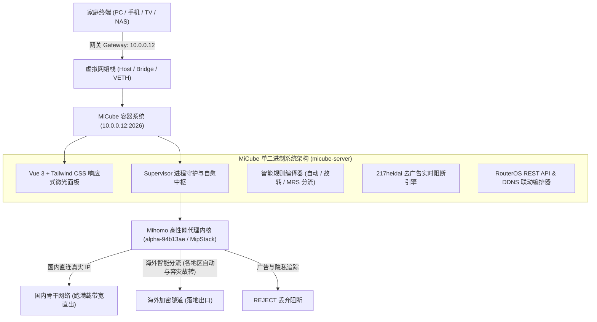
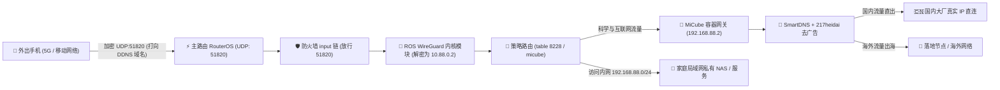

<div align="center">

  

  # 🧊 MiCube

  ### 专有高性能旁路由与多架构网关系统
  **Tailored for MikroTik RouterOS v7 · 飞牛 fnOS · PVE CT/LXC · NAS Docker**

  <p align="center">
    <a href="https://github.com/zyeyefyass/MiCube/releases"></a>
    <a href="https://github.com/MetaCubeX/mihomo"></a>
    <a href="https://hub.docker.com/r/fyasshole/micube"></a>
    <a href="https://github.com/zyeyefyass/MiCube/pkgs/container/micube"></a>
    <a href="https://golang.org"></a>
    <a href="https://vuejs.org"></a>
    <a href="#"></a>
    <a href="./LICENSE"></a>
  </p>

  <p align="center">
    <b>作者</b>: <a href="https://github.com/zyeyefyass">zyeyefyass</a> &nbsp;|&nbsp;
    <b>核心</b>: Mihomo (MetaCubeX) 最新测试版 alpha-94b13ae (MipStack + BBR) &nbsp;|&nbsp;
    <b>设计</b>: MikroTik 科技深蓝 (#001529 / #002d50 / #00d2ff)
  </p>

</div>

---

## 📖 项目简介与设计哲学 (Overview & Manifesto)

### 💡 为什么是 MiCube？—— 极客宣言与初心

> **「RouterOS 是路由系统的天花板，而 Mihomo 才是真正满血重生的 Clash！」**

很多网络玩家心中都有一个执念：主路由追求极致的电信级稳定与线速硬件吞吐，而科学旁路则渴望最灵活的分流与现代化协议支持。  
然而传统方案中，玩家们往往要在笨重臃肿的虚拟全家桶、频频死锁的防火墙脚本以及复杂的网关折返间身心俱疲。

**MiCube 的诞生，正是为了打破这种桎梏：**
- 🌾 **让普通人也能吃上饱饭**：秉持**「低配硬件高档享受」**的核心设计哲学。拒绝动辄要求 4 核 8G 的笨重运行时堆叠，采用纯自研 Go 单二进制重构，**系统总内存常驻仅 50MB 出头**（实机实测常驻仅约 52MB！安装包单二进制仅 10MB 出头，较传统旁路由节省 80% 内存）。几十块钱的二手工控机、单核 512MB 的小主机、甚至老旧家用 NAS 的边缘容器，都能轻盈驾驭，跑出满载极限性能！
- ⚡ **天花板遇上满血战神**：将**电信级路由天花板（RouterOS v7）** 与 **全协议硬件加速内核（Mihomo v1.19.32）** 深度糅合，打造真正意义上的**主旁一体（Master-Bypass Unified）** 透明旁路系统。
- 🧊 **极简开箱，主旁一体**：告别繁琐的手工 iptables 与网关死锁，开箱即用，后台 Supervisor 自愈守护，主路由负责光速转发，MiCube 负责全域智能分流。

---

### 🛡️ 为什么原生力推 WireGuard 移动端内网穿透？

在各类内网穿透工具层出不穷的今天，为什么 MiCube 依然坚持深度联动 **RouterOS 原生 WireGuard**？

1. 🚫 **彻底告别公网 IPv4 焦虑，告别运营商内网限制**：  
   如今家用宽带绝大部分被困在运营商的大内网（CGNAT / NAT444）中，想要公网 IPv4 往往需要昂贵资费或专线。WireGuard 深度配合 RouterOS 原生免费的 IP Cloud DDNS 或 IPv6 端点，**无需公网 IPv4 地址即可瞬间建立点对点安全隧道**，让内网穿透不再受制于运营商！
2. 🛡️ **彻底杜绝暴露内网 IPv6 的巨大安全风险（全屋设备绝对隐身）**：  
   很多新手获取了公网 IPv6 后，兴奋地将家里的 NAS、PC、摄像头直接开启 IPv6 对外开放——这是极度危险的“裸奔”行为！全世界的自动化扫描器与黑客脚本每天 24 小时在全网狂扫暴露的 IPv6 设备（勒索病毒、密码爆破、Web 漏洞入侵防不胜防）。  
   **WireGuard 是唯一的金牌安全护盾**：全屋所有的 NAS、电脑、摄像头等私有设备**无需对外暴露任何独立的 IPv6 地址或端口，在互联网上完全隐身**！全家仅有 RouterOS 上由强密码学签名保护的单个 UDP 端口作为唯一安全入口，外界没有正确密钥的探测包在底层直接被静默丢弃（Silent Drop），公网扫描如同面对一堵死黑洞，杜绝任何攻击面！
3. 🏠 **三层全网段直通，真正穿透整个家庭局域网 (Full-Subnet)**：  
   传统的 FRP、DDNSTO 等工具只能实现“单端口映射”（映射一个 Web 端口就要配置一次，繁琐脆弱且无法支持非 HTTP 协议）。而 WireGuard 建立的是**完整的三层网络隧道**：手机一旦连上，就像拉了一根无形的千兆光纤直接插入家里的主交换机！无需逐个端口配置，**瞬间穿透整个家庭局域网（`192.168.x.0/24`）**：NAS 文件共享（SMB / WebDAV）、远程桌面（RDP / VNC）、打印机、Home Assistant 智能家居、软路由后台随时秒级直达！
4. 💰 **永久 100% 完全免费，绝无第三方限速与隐私窥探**：  
   商业穿透工具（如蒲公英、花生壳、各类内网穿透 SaaS）不仅有高昂的月费门槛，而且往往限制 1~2Mbps 的蜗牛带宽、限制连接设备数量，数据还要经过第三方商业服务器中转。WireGuard + RouterOS 是 100% 纯自研与原生的底层方案，**零月租、零费用**，直接跑满您家庭宽带的物理上行带宽（千兆光纤满载跑满，外出串流 4K 原盘毫无卡顿）！
5. ⚡ **内核级极速 UDP，手机全天挂载零发热**：  
   WireGuard 基于极为精简现代的密码学（ChaCha20-Poly1305），直接运行在 Linux / RouterOS 内核空间。相较于传统 OpenVPN / IPsec 或用户态穿透工具，其上下文切换与协议握手开销近乎为零，**手机在后台挂载一整天几乎零额外耗电、机身不发热**，彻底告别移动端的发热掉电梦魇。
6. 🔄 **真正的端点无状态与无感热漫游 (Connection Roaming)**：  
   WireGuard 具有天才般的无状态连接特性。当您带着手机从家中 Wi-Fi 踏出大门、切换至户外 5G 移动网络时，即使客户端公网 IP 发生突变，**底层会话依然持续保活、连接完全不断流**，实现真正丝滑的无感漫游。
7. 🌐 **外出如在家，满血继承家庭局域网去广告与智能分流**：  
   当手机连上家里的 WireGuard 隧道后，所有 DNS 与网络流量将自动汇入 MiCube 的 SmartDNS 与 **217heidai 23 万条权威去广告引擎**。出门在外、连接公共 Wi-Fi 或蜂窝网络时，依然享受家中纯净、无污染、满载极速的加速体验！

---

## 🚀 Mihomo 官方测试版内核驱动 (alpha-94b13ae · MipStack 协议栈)

MiCube 全面采用 **[MetaCubeX/mihomo](https://github.com/MetaCubeX/mihomo) 官方最新 Alpha 测试版内核（alpha-94b13ae）** 作为底层核心代理引擎，由 Go 单二进制守护进程 `micube-server` 提供企业级进程生命周期守护、配置动态编译与热重载：

- 🌐 **全协议全栈硬件加速**：完整支持 Shadowsocks、VMess、VLESS、Trojan、Hysteria 2、TUIC v5、WireGuard 等现代高性能代理协议。
- ⚡ **TUN MipStack 轻量高性能用户态协议栈 (`mips`)**：全面对齐 Mihomo 最新自研 IP 栈，纯 Go 编写、零 CGO 依赖、支持批量包处理与零拷贝复用，内存开销较 gVisor 降低 40% 以上，极度适配软路由/容器低内存环境。
- 🏎️ **原生集成 Google BBR / BBRv3 拥塞控制**：内置 `congestion-controller: bbr` 算法加速，在跨洋高丢包、大延迟长肥管道下依然实现线速满带宽吞吐。
- 🎯 **各地区自动优选与容灾故转**：实时并发测速选路（`url-test`）与健康探针故障转移（`fallback`）双模并行。
- 🗜️ **现代化 MRS 二进制规则格式**：支持高速 Meta Ruleset，23 万+ 去广告与隐私规则毫秒级检索，内存占用缩减 80% 以上。
- 🛡️ **内存软上限与防 OOM 治理**：原生注入 `GOMEMLIMIT=40MiB` 与 `GOGC=30`，杜绝软路由与容器环境下的内存溢出崩溃。

---

## 📸 核心模块实机展示与特性详解 (Features & Showcase)

### 1. 现代化微光仪表盘 · 电信级全景实时监控
深度统筹内核生命周期与系统性能，毫秒级响应，总内存常驻仅 **50MB 出头**（实机实测常驻约 52.4MB）。

<p align="center">
  
</p>

- ⚡ **电信级宿主平台识别**：智能探查并展示 RouterOS v7.x、Linux VM 或 NAS Docker 官方纯矢量 Logo 识别徽章（如 `RouterOS v7.18.2 (stable)`）；
- 📈 **60fps 高精度平滑网络流速波形**：实时呈现全屋设备的上行、下行瞬时流量与活跃连接链路；
- 🛡️ **Supervisor 守护中枢**：支持一键启动、停止、热重载与守护进程崩溃自愈，开机自动托管。

---

### 2. 节点选择与策略组管理 · 毫秒级单点并发测速与手动自由切选
全新独立【节点选择】控制台，提供比肩顶级客户端的操控体验。

<p align="center">
  
</p>

- ⚡ **毫秒级单点与并发测速**：一键刷新整组节点延迟，三色延迟胶囊（<150ms 翠绿极速 / <300ms 暖橙良好 / 超时 绯红告警）；
- 🎛️ **多层级策略组智能筛选**：支持「全部分组、自动选路 (url-test)、故障转移 (fallback)、直连、手动选择 (selector)」一键分类筛选；
- 🎯 **一键无缝切换活动节点**：实时向底层 Mihomo 注入选路指令，即切即用，零网络抖动中断；
- 🔍 **智能清洗假节点与精准计数**：彻底过滤机场公告、剩余流量等无效节点，精准识别 `1Gbps`、`10Gbps` 及海外地区节点，节点统计 100% 真实。

---

### 3. 订阅管理与出口策略组 · 四大策略模式详解与选型指南
分流规则彻底摆脱传统手写配置痛点，可视化轻松掌控复杂分流策略。

<p align="center">
  
</p>

#### 🧭 地区策略四大模式核心区别与选型决策指南 (小白必读)

| 策略模式 | 底层类型 | 工作机制 | IP 表现 | 最适业务场景 (何时选它？) | 避坑提醒 (何时慎用？) |
| :--- | :--- | :--- | :--- | :--- | :--- |
| **⚡ 地区自动**<br/>(如 `香港自动`) | `url-test`<br/>并发测速选优 | 后台每 300s 向探针并发测速，**自动选用延迟最低、起步最快的节点** | 动态漂移<br/>(随延迟切换) | **网页浏览 / 刷短视频 / 大文件下载**：YouTube、B站海外版、TikTok、普通资讯、App 更新，追求最低加载等待时间与最大吞吐带宽。 | ⚠️ 严禁用于网银与外服游戏排位，节点频繁切换会导致异地登录被风控或游戏掉线重连。 |
| **🛡️ 地区故转**<br/>(如 `香港故转`) | `fallback`<br/>主备顺序顺延 | 严格按列表顺序排队，**只要第 1 顺位节点存活，就死死锚定在该节点，绝不随意跳 IP**！主节点故障才顺延降级给下一个节点，恢复后平滑回切。 | 固若金汤<br/>(长周期绝对固定) | **AI 大模型 / 海外网银 / 远程办公**：ChatGPT、Claude、Midjourney、PayPal、Stripe、虚拟币交易所、远程 SSH / 桌面 RDP 等对 IP 漂移极度敏感的业务。 | ⚠️ 若第 1 顺位节点延迟略高，系统也不会擅自切到低延迟节点（以 IP 绝对稳定为第一优先级）。 |
| **🌐 地区容灾**<br/>(如 `香港容灾`) | `fallback`<br/>灾备应急备选 | 专用于聚合该地区的多源备用线路、低倍率保底节点或次级机场链路，独立于主生产环境之外作为二级冷备份池。 | 灾备隔离<br/>(独立备选池) | **关键时刻救命兜底**：当遇到特殊时期、主力机场大面积遭遇 DDOS 攻击、或干线海缆突发故障全线翻红时，一键将出口切至该组秒级恢复通信。 | ⚠️ 平时作为冷备用，无需挂载所有日常高带宽下载业务。 |
| **🎯 地区手动**<br/>(如 `香港手动`) | `select`<br/>人工定点锁定 | 纯静态人工单选组。用户在【节点选择】控制台选定哪个节点，流量就 **100% 且永久锁定在该节点**，系统绝不做任何自动化切换。 | 绝对人工控制<br/>(人工选定即锁定) | **外服联机电竞 / 定点流媒体解锁**：Steam / Epic / 瓦罗兰特 / Apex 游戏必须固定特定专线（如 IPLC 香港 01）；特定地区限定影视库定点解锁；网络排障抓包。 | ⚠️ 一旦该手动节点离线，系统不会自动替你切备用节点，需要人工干预重新选择。 |

#### 💡 场景速查选型口诀：
* **日常冲浪刷视频** ➔ 选 **⚡ 地区自动**（谁快用谁，流畅起播）；
* **ChatGPT / 网银炒币** ➔ 选 **🛡️ 地区故转**（IP 坚固不跳，告别封号风控）；
* **主机联机 / 电竞专线** ➔ 选 **🎯 地区手动**（锁定低抖动 IPLC，拒绝漂移掉线）；
* **干线海缆故障 / 机场瘫痪** ➔ 选 **🌐 地区容灾**（多源备用线路一键救命）。

---

- 🔄 **微动模式切换**：支持 `✎ / ▾` 微动按钮快速切换预设下拉与自定义手动输入，兼具易用性与扩展性；
- 🌐 **国内直连显示真实 IP（黑科技）**：智能将国内大厂与局域网流量彻底绕过 Fake-IP 映射池，由国内 DNS 直接解析真实公网 IP 直连直出，**不占内核 CPU，跑满满载带宽**，BT/PT 与游戏联机零阻碍；
- ⚡ **海外 QUIC (UDP 443) 优化**：智能阻断劣质 UDP，迫使 YouTube / Chrome 回退至 TCP TLS，享受节点 BBR 算法强力加速，彻底消除 4K 缓冲转圈与丢包。

---

### 4. 217heidai 全网去广告与隐私防追踪 · 毫秒级直接丢弃
集成全网权威反追踪规则库，还家庭一个清爽无污染的网络空间。

<p align="center">
  
</p>

- 🛑 **23.3 万条权威规则秒级检索**：集成 217heidai 权威二进制规则集（`adblockmihomo.mrs`）与 MetaCubeX 隐私库，加载逾 **233,481 条** 过滤规则；
- 📊 **今日拦截计数与全局开关**：一键开启全屋防护，毫秒级 REJECT 阻断，零带宽损耗；
- 🔍 **实时已拦截域名与请求流监控**：精准记录全屋手机（如 iPhone 16）、电脑（MacBook Pro）、电视（小米电视）触发的广告推送与隐私遥测，清晰可查。

---

### 5. WireGuard 移动端内网穿透 · 外出手机一键扫码回航
将 RouterOS 电信级底层能力与现代轻量级 UDP 穿透协议深度打通。

<p align="center">
  
</p>

- 📱 **一键生成手机 WireGuard 二维码**：无需繁琐手动抄写密钥与 Endpoint，点击「扫码配置」手机一照即刻配对；
- 🔄 **端点无状态与无感热漫游**：外出从 Wi-Fi 切换到 5G 移动蜂窝网络，IP 突变会话不断流；
- 🔋 **内核级 UDP 极速响应**：手机全天挂载后台几乎零额外耗电、机身不发热；
- 🛡️ **外出如在家，继承全局去广告与分流**：在外连接公共 Wi-Fi 时，所有流量安全回航经由家中 MiCube 处理，外出同样享受纯净高速网络。

---

### 6. 双模极客响应式设计 · 手机移动端极致优化
无论在大屏电脑前还是躺在沙发握着手机，都能获得丝滑一致的掌上运维体验。

<p align="center">
  
  &nbsp;&nbsp;&nbsp;&nbsp;
  
</p>

- 📱 **灵动微光顶栏**：Mini 胶囊实时展现当前状态、运行时间与宿主平台徽章；
- 🎛️ **极客悬浮毛玻璃 Dock 栏**：专为移动端单手操作优化，完美避开 iPhone 刘海屏与底栏 Home 条；
- 💻 **全功能不阉割**：手机端直接支持节点测速切选、策略组切换、查看拦截流与重启核心。

---

## 🏛️ 系统架构 (Architecture)



---

## 🧭 【小白必读】旁路由无感安全接入三步法则

> [!IMPORTANT]
> 很多新手最担心“一改网关，全家断网”。请牢记以下**安全部署三法则**，100% 避免误操作：
> 1. **先起容器，再进后台**：先按下方对应系统教程启动容器，在浏览器中打开 `http://你的设备IP:2026`，看到蓝色控制台且左上角显示**「核心运行中」（绿灯）**。
> 2. **先导节点，测通延迟**：在【节点选择】页面点击右上角导入你的订阅链接，点击“测速”，确保节点列表出现绿色延迟数字。
> 3. **单机验证，绝不断网**：先拿自己的一台手机或电脑，手动修改该设备的网关与 DNS 为 MiCube 的 IP 测试。验证 YouTube / Google / 微信完全秒开无误后，再决定是否在主路由器 DHCP 中全局应用！

---

## 🚀 新手极简部署指南 (Step-by-Step Installation)

支持主流 NAS 与软路由系统，镜像已支持 **AMD64 (x86_64) 与 ARM64 双架构**：
- **Docker Hub 公共镜像（全平台搜索通用）**：`fyasshole/micube:latest`
- **GitHub GHCR 备用镜像**：`ghcr.io/zyeyefyass/micube:latest`
- **离线安装包（无需外网）**：前往 [Releases 页面](https://github.com/zyeyefyass/MiCube/releases) 下载纯 `.tar` 离线镜像包：`MiCube-amd64.tar` 或 `MiCube-arm64.tar`（无需繁琐二次解压，直接导入）。

---

### 🌟 方案一：飞牛私有云 (fnOS) Docker 部署教程

> [!TIP]
> 推荐直接使用 **方法 A（图形化界面）**，全程鼠标点击，不需敲击任何一行黑底代码！

#### 方法 A：飞牛桌面【Docker 容器】图形界面部署（纯小白首选）

1. **下载或导入镜像（二选一）**：
   - **在线搜索拉取**：打开飞牛桌面 -> 进入【Docker】应用 -> 点击左侧【镜像仓库】 -> 顶部搜索栏输入 **`fyasshole/micube`** -> 点击搜索并下载（版本选择 `latest`）。
   - **离线本地导入**：若 NAS 下载外网较慢，可在电脑前往 [Releases 页面](https://github.com/zyeyefyass/MiCube/releases) 直接下载 **`MiCube-amd64.tar`**；在飞牛 Docker【本地镜像】界面点击【导入】，直接选择该 `.tar` 文件上传（免去二次解压烦恼！），1 秒极速导入！
2. **创建容器**：
   - 在【本地镜像】列表中找到下载好的 `micube`，点击右侧的【创建容器】。
   - **容器名称**：填写 `micube`；
   - **自动重启**：勾选【开机自动启动】。
3. **⚠️ 关键设置（最核心两步，务必勾选正确）**：
   - **网络设置**：网络模式下拉选择 **`host`（主机网络模式）**。*(注意：千万不要选 bridge，否则局域网无法接入)*
   - **高级权限**：勾选 **【以高权限运行容器】（Privileged 模式）**。*(注意：必须勾选，用于系统加载 TUN 虚拟网卡)*
4. **存储空间映射**：
   - 点击添加文件夹映射（本地路径可自由存放在您的任意共享文件夹中，例如 `docker/micube`）：
     - 本地路径选择：`docker/micube/data` ➔ 容器路径填写：`/opt/MiCube/data`
     - 本地路径选择：`docker/micube/etc` ➔ 容器路径填写：`/opt/MiCube/etc`
5. **启动与进入控制台**：
   - 点击【完成】，容器即刻启动。
   - 打开电脑或手机浏览器，访问：**`http://你的飞牛IP:2026`**  
     *(例如飞牛后台是 192.168.1.5:5678，则输入 `http://192.168.1.5:2026`)*，立即进入控制台！

---

#### 方法 B：飞牛【项目 (Compose)】一键部署

1. 打开飞牛【Docker】-> 点击左侧【项目】-> 点击【创建项目】；
2. 项目名称填写 `micube`，在配置文本框中粘贴如下代码：

```yaml
version: '3.8'

services:
  micube:
    image: fyasshole/micube:latest
    container_name: micube
    restart: always
    network_mode: host
    privileged: true
    devices:
      - /dev/net/tun:/dev/net/tun
    volumes:
      # 采用相对路径，飞牛会自动在项目所在目录创建 data 与 etc 文件夹，绝对不会路径报错！
      - ./data:/opt/MiCube/data
      - ./etc:/opt/MiCube/etc
    environment:
      - TZ=Asia/Shanghai
      - PORT=2026
```
3. 点击【构建并启动】，等待 3 秒即可完成部署。

---

### ⚡ 方案二：Proxmox VE (PVE) LXC / CT 容器极速部署

在 PVE 中采用 **LXC (CT) 容器** 运行，内存仅占 ~80MB，性能损耗为 0。

> [!WARNING]
> **PVE 新手三大避坑红线：**
> 1. 创建容器常规设置中，**必须取消勾选【无特权容器】**（即必须创建特权容器）！
> 2. 网络 IP 必须是**您家路由器的相同网段**，不要死抄！例如主路由是 `192.168.1.1`，此处可填 `192.168.1.200/24`，网关填 `192.168.1.1`！
> 3. 修改配置文件时，文件名的数字是你自己容器的 ID（例如 100 就改 `100.conf`）！

#### 步骤 1：PVE 宿主机开启 TUN 模块支持
进入 PVE 节点的【Shell】终端，粘贴执行：
```bash
# 加载 tun 模块并写入开机自启
modprobe tun
grep -q "^tun$" /etc/modules || echo "tun" >> /etc/modules
ls -l /dev/net/tun
# 显示 crw-rw-rw- 即表示宿主机已准备就绪
```

#### 步骤 2：创建特权 LXC 容器
1. PVE 网页右上角点击【创建 CT】；
2. **常规**：CT ID 记录下来（如 `108`），密码自定，**务必取消勾选【无特权容器】**；
3. **模板**：选择最新官方 `debian-12-standard` 或 `alpine-3.20` 模板；
4. **磁盘与内存**：磁盘分配 4G 即可，内存 512MB；
5. **网络**：桥接选 `vmbr0`，IPv4 填写：`你的局域网未占用IP/24`（如 `192.168.1.200/24`），网关填写主路由 IP（如 `192.168.1.1`）；
6. 完成创建，**先不要开机！**

#### 步骤 3：为容器直通虚拟网卡权限
回到 PVE 宿主机的【Shell】终端，输入编辑命令（将 `108` 替换为你的容器真实 ID）：
```bash
nano /etc/pve/lxc/108.conf
```
按下键盘方向下键滑到最底部，粘贴以下 3 行直通参数：
```ini
lxc.cgroup2.devices.allow: c 10:200 rwm
lxc.mount.entry: /dev/net/tun dev/net/tun none bind,create=file
lxc.apparmor.profile: unconfined
```
按快捷键 `Ctrl + O` 保存，回车确认，再按 `Ctrl + X` 退出编辑器。

#### 步骤 4：进入容器并启动 MiCube
1. 在 PVE 网页启动该容器，点击进入【控制台 (Console)】，输入 root 及你设定的密码登录；
2. 开启内核数据包转发并运行容器：
```bash
# 1. 开启 IPv4 转发
echo "net.ipv4.ip_forward = 1" >> /etc/sysctl.conf
sysctl -p

# 2. 安装 Docker (如已安装可跳过)
curl -fsSL https://get.docker.com | sh

# 3. 运行 MiCube 容器
docker run -d \
  --name micube \
  --restart always \
  --net host \
  --privileged \
  -v /dev/net/tun:/dev/net/tun \
  -v ./data:/opt/MiCube/data \
  -v ./etc:/opt/MiCube/etc \
  fyasshole/micube:latest
```
3. 打开浏览器访问：`http://你刚才分配给CT容器的IP:2026`（例如 `http://192.168.1.200:2026`）。

---

### 🌐 方案三：MikroTik RouterOS v7 原生容器一键部署

在 RouterOS WinBox 打开 **Terminal** 终端，将参数中的 IP 替换为您 RouterOS 的实际局域网网段执行：

```routeros
# 1. 创建专用虚拟网卡并加入默认网桥 (例如你的 ROS 网段为 192.168.88.x)
/interface/veth/add name=micube address=192.168.88.2/24 gateway=192.168.88.1
/interface/bridge/port add bridge=bridge interface=micube

# 2. 从 Release 页面下载 MiCube-amd64.tar (x86) 或 MiCube-arm64.tar (ARM) 上传至 ROS 磁盘
# 在 WinBox -> Files 确认磁盘挂载名称 (通常为 disk1 或 usb1)
/container/config/set tmpdir=disk1/pull
/container/add file=disk1/MiCube-amd64.tar interface=micube root-dir=disk1/micube \
    envlist="" hostname=MiCube logging=yes start-on-boot=yes

# 3. 启动并运行
/container/start [find where interface=micube]
```

访问地址：👉 **`http://192.168.88.2:2026`**

---

### 💻 方案四：通用 Linux 服务器 / 虚拟云主机 Docker 部署

```bash
docker run -d \
  --name micube \
  --restart always \
  --net host \
  --privileged \
  --cap-add NET_ADMIN \
  --cap-add NET_RAW \
  -v /dev/net/tun:/dev/net/tun \
  -v ./data:/opt/MiCube/data \
  -v ./etc:/opt/MiCube/etc \
  -e TZ=Asia/Shanghai \
  -e PORT=2026 \
  fyasshole/micube:latest
```

---

## 📱 终端设备如何接入旁路由？（手把手教学）

假设您的主路由器 IP 为 `192.168.1.1`，MiCube 运行在 `192.168.1.200`：

### 1. 苹果手机 / iPad 设置方法：
1. 打开【设置】->【无线局域网】-> 点击已连接 Wi-Fi 旁边的 **ⓘ 图标**；
2. 往下拉找到【配置 IP】，将“自动”改为**“手动”**：
   - **IP 地址**：填写 `192.168.1.88`（与原 Wi-Fi 相同网段的未占用 IP）
   - **子网掩码**：`255.255.255.0`
   - **路由器**：填写 **`192.168.1.200`**（重点！改为 MiCube 的 IP）
3. 找到【配置 DNS】，将“自动”改为**“手动”**：
   - 删除原有 DNS，新增一条：**`192.168.1.200`**（重点！改为 MiCube 的 IP）
4. 点击右上角【存储】，打开 Safari 浏览器访问 Google 或 YouTube，秒开即代表接入成功！

### 2. 安卓手机 / 鸿蒙系统设置方法：
1. 进入【设置】->【WLAN】-> 长按当前连接的 Wi-Fi -> 选择【修改网络】；
2. 展开【高级选项】->【IP 设置】由 DHCP 改为 **静态**：
   - **网关**：填写 **`192.168.1.200`**（MiCube 的 IP）
   - **DNS 1**：填写 **`192.168.1.200`**
3. 保存即可。

### 3. Windows 电脑设置方法：
1. 打开【控制面板】->【网络和共享中心】-> 点击当前连接的【以太网】或【WLAN】；
2. 点击【属性】-> 双击【Internet 协议版本 4 (TCP/IPv4)】；
3. 选择“使用下面的 IP 地址”：
   - **默认网关**：填写 `192.168.1.200`
   - **首选 DNS 服务器**：填写 `192.168.1.200`
4. 点击确定保存。

### 4. 全局无感接入（全家设备免配置）：
在您的一台手机或电脑按上述步骤单机验证完全正常后，打开主路由后台（如华硕、爱快、OpenWrt、小米）：
- 进入【局域网 (LAN) 设置】/【DHCP 服务】；
- 将 DHCP 下发的 **网关** 与 **主 DNS** 直接修改为 `192.168.1.200` 并保存；
- 全家所有设备只需断开 Wi-Fi 重新连接，无需任何设置，即可全自动享受满载透明分流与去广告！

---

## 🛡️ 【小白必读】WireGuard 移动端内网穿透与全天漫游四步法

> [!IMPORTANT]
> **很多新手最头疼的问题**：到底是先调防火墙？先在 ROS 里对齐？还是先在手机上扫码？为什么我扫了码手机一直在转圈握手失败？  
> 请务必遵循 **「① 先对齐 ROS ➔ ② 先调防火墙与策略路由 ➔ ③ 后在面板扫码 ➔ ④ 断开 Wi-Fi 验证」** 的标准执行序列！顺序颠倒极易造成握手超时或断网。

### 🌟 为什么 WireGuard 是秒杀一切商业穿透的终极方案？

| 维度 | 传统商业穿透 (如某壳/某联/FRP公共服务) | 直接暴露 IPv6 到公网 (新手常见做法) | 🧊 MiCube + RouterOS 原生 WireGuard |
| :--- | :--- | :--- | :--- |
| **公网 IPv4 需求** | 不需要（依赖厂商服务器中转） | 不需要（仅限 IPv6） | **完全不需要** (配合 ROS 免费 IP Cloud DDNS 或 IPv6 隧道) |
| **设备安全与暴露风险** | 账号或中转服务器有数据泄露风险 | 🔴 **极度危险** (所有内网 NAS/PC 端口直接暴露在公网，遭遇全天候暴力破解与勒索病毒) | 🟢 **军工级隐身** (内网设备 0 暴露，公网仅暴露 1 个 WireGuard 端口，无签名探测直接静默丢弃，公网扫描呈黑洞状态) |
| **穿透范围** | 仅单端口 / 单应用 (映射一个配一个) | 仅有 IPv6 地址的单台设备 | 🟢 **穿透整个局域网 (L3 全网段)** (连上即如插千兆网线，直达局域网所有 NAS/PC/打印机/摄像头) |
| **带宽与费用** | 🔴 收费昂贵，免费版限速 1~2Mbps 龟速 | 取决于宽带，但受限于跨网 IPv6 互通 | 🟢 **永久 100% 免费** (无任何商业收费，满载跑满家庭千兆宽带物理上行极限) |
| **手机耗电与发热** | 用户态协议，后台耗电高、机身发热 | 直连，但应用无统一加密通道 | 🟢 **内核态极速运行，全天挂载零发热、零掉电** |
| **网络漫游体验** | 切换网络经常掉线重连 | IP 变化即中断 | 🟢 **端点无状态，Wi-Fi 切 5G 移动网络无感秒级热漫游** |

---

### 🌐 一张图看懂数据流转原理 (Data Flow Architecture)



---

### 📋 严格执行四步法（为什么这个顺序绝不能颠倒？）

#### 🥇 第一步：先一键对齐 ROS (服务端端点、密钥与 DDNS 准备)
- **底层原理**：手机 WireGuard 客户端就像一把钥匙，ROS 上的 `wireguard1` 接口就像一把锁。在给手机配钥匙之前，必须先在锁里把**门牌号（公网 IP 或 Cloud DDNS 域名）**、**门铃端口（UDP 51820）**、**服务端公钥**与**隧道内网网段（如 10.88.0.1/24）**固定下来。如果这一步不对齐，后面生成的二维码配置就是“空号”或“错号”，手机扫了也是徒劳。
- **操作方式**：
  1. 在 MiCube 面板点击左侧【WireGuard】；
  2. 检查顶部的对齐状态矩阵，若显示未对齐，直接点击**「⚡ 一键对齐 RouterOS」**；
  3. MiCube 将通过 REST API 自动在 ROS 创建并校准 `wireguard1` 接口、生成私钥公钥、设置端口为 `51820`、绑定 `10.88.0.1/24` 并探查 ROS IP Cloud 动态域名。

#### 🥈 第二步：先调防火墙与策略路由规则 (大门放行与通道引流)
- **底层原理（新手最常踩的大坑！）**：
  - **防火墙必须先放行**：RouterOS 默认的防火墙安全机制极为严格，Filter Rules 的 `input` 链默认**直接丢弃 (DROP) 所有来自外网 WAN 口的未知连接**！即使第一步建好了 WireGuard 接口，如果不提前在防火墙放行 UDP 51820 端口，运营商进来的握手包会在第一道关卡被直接丢进垃圾桶。**如果先扫码连手机，手机发出的握手信号根本进不来，客户端会一直显示 `Handshake did not complete after 5 seconds`**！
  - **策略路由必须提前引流**：手机连入后分配的是 `10.88.0.x` 内网 IP。如果策略路由没有将 `10.88.0.0/24` 纳入分流标记，手机就算连回家也只能访问局域网 NAS，无法通过 MiCube 翻墙出海。
- **操作方式**：
  1. 在 MiCube 面板【系统状态】或 WireGuard 诊断卡片中，点击**「⚡ 一键配置防火墙与策略路由」**；
  2. 后台全自动在 ROS `ip firewall filter` 的 input 链顶部插入 `accept protocol=udp dst-port=51820` 放行规则，并自动下发 `table 8228` 策略路由引流规则。

#### 🥉 第三步：后在 Web 界面扫码导入手机 WireGuard
- **底层原理**：此时大门（防火墙端口）已敞开、路标（策略路由）已立好、端点（DDNS 与接口密钥）已对齐。此时在 MiCube 面板为手机创建 Peer，手机扫码即可直接握手成功。
- **操作方式**：
  1. 在手机应用商店（App Store / Google Play / 官方 APK）下载安装 **WireGuard** 官方客户端；
  2. 在 MiCube 面板【WireGuard】设备列表中，找到您的手机（或点击右上角「+ 添加设备」如 `iPhone 16 Pro`），点击右侧的**「📱 扫码配置」**；
  3. 手机打开 WireGuard App，点击右上角 `+` -> 选择 **「扫描二维码」**，扫描电脑屏幕上的二维码，命名保存并开启连接开关；
  4. 此时手机发出第 1 个 UDP 握手包，ROS 秒级响应，手机 WireGuard 界面内的「最新握手 (Latest Handshake)」在 1 秒内变为绿色（例如 `5 秒前`），同时产生双向传输数据流量！

#### 🏅 第四步：手机断开 Wi-Fi，切蜂窝移动网络验证
- **底层原理**：在手机连接家中 Wi-Fi 时测试穿透，可能会因路由器 NAT 回流（Hairpin NAT）未配置而连不上或产生假象。真正的内网穿透是在外面出差、旅游、喝咖啡时的漫游场景。
- **操作方式**：
  1. **关闭手机 Wi-Fi 开关**，切至运营商 5G / 4G 移动网络；
  2. 保持手机 WireGuard 处于已连接状态；
  3. **内网直通验证**：在手机 Safari / 浏览器中直接输入家庭内网 NAS 或路由器地址（如 `http://192.168.88.1` 或 `http://192.168.88.5:5000`），秒级打开即代表内网穿透成功！
  4. **全天漫游分流验证**：打开 YouTube 或 Google，秒开 4K 视频且无任何广告，证明手机已成功继承家中 MiCube 的全套 217heidai 去广告与 SmartDNS 加速能力！

---

## ❓ 常见新手排障问答 (Troubleshooting FAQ)

<details>
<summary><b>Q1: 容器启动了，为什么浏览器打不开 :2026 后台？</b></summary>
<br/>
1. 请检查创建容器时<b>网络模式是否选为了 host</b>。如果误选为 bridge，容器无法绑定主机端口；<br/>
2. 检查宿主机防火墙是否放行了 2026 端口；<br/>
3. 检查浏览器输入的 IP 是否是 NAS 或宿主机的真实局域网 IP。
</details>

<details>
<summary><b>Q2: 手机改了网关后，国内微信和网页正常，但打不开国外网站？</b></summary>
<br/>
1. 打开 MiCube 后台，点击左侧【节点选择】；<br/>
2. 确认是否已成功导入了有效的订阅节点，并点击“测速”，确保节点后方有绿色的延迟数字；<br/>
3. 确认左上角的「核心运行中」绿灯常亮。
</details>

<details>
<summary><b>Q3: 国内直连是否会消耗旁路由的 CPU？微信发图片会不会卡？</b></summary>
<br/>
完全不会！MiCube 拥有独创的<b>国内真实公网 IP 直连直出机制</b>，微信、淘宝、抖音、B站等国内大厂流量由 SmartDNS 直接解析为真实公网 IP，完全绕过 Fake-IP 池，不走内核加解密，直接由物理网卡线速转发，跑满满载带宽且 CPU 占用近乎为 0。
</details>

---

## 🔄 版本更新日志与迭代历程 (Changelog)

### 🧊 Test V0.8 (2026-10-15) · 系统内存降至 50MB 出头、单二进制 10MB 出头、全新独立节点选择控制台与 WireGuard 权威指南
- 🚀 **系统常驻内存压榨至 50MB 出头 (实机 52.4MB) 与 10MB 安装包**：
  - 核心 TUN 协议栈深度对齐 Mihomo 最新 MipStack (`mips`)，纯 Go 零 CGO 零拷贝，结合 `GOMEMLIMIT=40MiB` 与 `GOGC=30`，常驻内存由 ~90MB 剧烈收缩至 **52.4MB**，相较传统方案省 80% 内存；
  - 后端单二进制经过符号剥离与编译优化，全平台尺寸控制在 10MB 出头（amd64 仅 12.6MB，arm64 仅 11.8MB）。
- 🎛️ **全新独立【节点选择】控制台与实时交互**：
  - 新增全功能【节点选择】交互视窗，支持单节点及策略组毫秒级并发延迟测速；
  - 呈现直观三色延迟胶囊（<150ms 翠绿 / <300ms 暖橙 / 超时 绯红），支持按「全部分组、自动选路、故障转移、直连、手工选择」一键分类筛选；
  - 修复机场无效节点过滤算法，彻底解决将包含带宽标识（如 `1Gbps`、`10Gbps`）或英国 `GB` 国家标签误杀的缺陷，订阅节点计数 100% 真实。
- 🛡️ **出口策略组细化重构：地区故转 vs 地区容灾**：
  - 消除原“故转”与“故障转移”重复简称歧义，规范划分为「🛡️ 地区故转 (顺序顺延 / IP稳定，适合 ChatGPT 与网银)」与「🌐 地区容灾 (应急备选灾备)」及「⚡ 地区自动 (最低延迟优先)」；
  - 编译器与前端控制面板无缝联动对齐。
- 📱 **WireGuard 权威使用指南与四大优势规范**：
  - 详尽剖析 WireGuard **无需公网 IPv4、彻底规避暴露内网 IPv6 高危风险、三层穿透整个局域网、100% 永久免费与军工级静默安全** 五大核心优势；
  - 确立「① 先对齐 ROS ➔ ② 先调防火墙与策略路由 ➔ ③ 后在面板扫码 ➔ ④ 断开 Wi-Fi 验证」标准执行四步法与原理流程图。

### 🧊 Test V0.7 (2026-10-15) · 飞牛 (fnOS) / Linux 宿主机深度协同、同网段多网关自愈分流与 RouterOS 完整版本真机呈现
- 🖥️ **飞牛 (fnOS) / Linux 宿主机深度协同与 Docker 穿透优化**：
  - 为 Docker 部署模式量身打造宿主机 SSH 协同引擎（支持飞牛 fnOS、PVE、群晖 DSM、Debian/Ubuntu 等 Linux 宿主）；
  - 支持一键部署宿主机 WireGuard 服务（`wg0.conf`、开机自启、开启内核 IPv4 转发与 UDP 13231 防火墙放行），绕过 Docker 网桥实现千兆内网线速直通；
  - Web 界面增删/重命名 WireGuard 客户端时，后台全自动静默向宿主机执行 `wg set wg0 peer ...` 动态热对齐；
  - 提供宿主机免密 1 键 Shell 脚本（`curl | sudo bash`），无须在面板保存 SSH 凭证即可 2 秒完成配置；
  - 支持宿主机系统升级在线检测与一键升级（`apt update && apt upgrade -y` / fnOS 更新），面板内置实时终端日志视窗。
- 🛡️ **同号段多网关 / 传统纯旁路由模式避坑与 1 键净化**：
  - 深度治理同局域网存在多个网关或 DHCP 下发自定义 DNS 时的冲突痛点：优化 RouterOS DNS 重定向规则，限制仅对发往主路由的直连请求生效，杜绝向其他同号段网关/DNS 发包时的递归死锁；
  - 新增「🌾 一键停用 Mangle/DNS 劫持 (经典纯旁路由模式)」，支持一键移除 RouterOS 强控标记，局域网终端只需将网关/DNS 手动指向 MiCube 即可享受全功能科学分流，与局域网其他网关互不干扰。
- 🏷️ **RouterOS 完整版本号全真呈现 (Zero Truncation)**：
  - 彻底重构平台探查与格式化逻辑，移除历史版本硬编码截断，优先读取真机固件版本与硬件架构（如 `RouterOS v7.18.2 (stable)`、`RouterOS v7.18.2 · CHR`）；
  - 面板顶栏、左侧栏 Hero 徽章、移动端抽屉与仪表盘平台卡片全方位拓宽视宽并附带完整悬浮浮窗提示。
- ⚡ **对齐 Mihomo 最新 Alpha 内核协议规范**：
  - 启用新一代 `endpoint-independent-nat: true`（全锥型 NAT 优化）；
  - TUN 栈原生支持 `mips` 轻量高效栈；
  - 注入高频国内直连 UDP 首包并发竞速（阿里 `223.5.5.5` + 腾讯 `119.29.29.29`）。

### 🧊 Test V0.6 (2026-10-15) · RouterOS 原生联动对齐、全自动策略路由下发与灾备系统
- 🛡️ **RouterOS 防火墙与策略路由全自动体检与一键配置**：
  - 新增专用策略路由诊断矩阵，自动体检 `/routing/table`（`micube` 表）、默认网关路由（`0.0.0.0/0 via MiCube`）、Mangle prerouting/redirect 标记（`mark: 0x2026`）、防死锁回环白名单（`MICUBE_BYPASS`）以及严格防 DNS 泄露规则（53 端口重定向与 SERVFAIL 阻断）。
  - 支持在 Web 面板直接点击「⚡ 一键配置到 RouterOS」通过 REST API 全自动下发就绪，无需手动操作 WinBox。
- ⚡ **取消复制终端命令行，全面升级为 REST API 原生直通**：
  - 取消弹窗强制要求用户复制 WinBox 脚本的旧操作，WireGuard 服务端、客户端 Peers 以及策略路由全部由后台 REST API 原生直通；
  - 依然贴心保留「WinBox 终端脚本 (备用)」一键复制选项，供无 REST API 环境手工审计备用。
- 📱 **WireGuard 与 RouterOS 实时对齐矩阵**：
  - 新增 WireGuard 接口、IP 网段、UDP 防火墙端口、IP Cloud 动态域名及所有 Peer 授权密钥的实时对齐检查卡片与一键对齐按钮；
  - 支持已授权客户端 Peer 在线重命名（`✏️ 改名`），名称自动同步至 RouterOS comment 备注。
- 🌏 **严格 7 大标准地区分组与零乱码保证**：
  - 节点地区分组严格限定为「香港、台湾、新加坡、韩国、日本、美国、其它」，其余所有未知地区节点一律自动汇入「其它」，彻底规避杂乱自定义分组；
  - 核心订阅编译器注入 UTF-8 严格清洗，全栈 HTTP/JSON/静态文件响应注入 `charset=utf-8`，彻底消除不同操作系统下的字符乱码问题。
- 💾 **系统配置全量备份与一键恢复 (Backup & Restore)**：
  - 新增系统全量配置导出与恢复引擎，支持一键导出包含节点订阅、分流规则、WireGuard 服务端与 Peer 私钥、RouterOS 凭据与设备备注的 `.json` 灾备文件；
  - 支持在任何全新或迁移设备上一键导入秒级还原，零数据丢失。
- 🏷️ **局域网设备按 IP 与 MAC 自定义备注**：
  - 设备管理与实时会话中全面支持按设备 IP 地址或 MAC 物理地址绑定友好名称（如“客厅电视”、“NAS”），多视图统一联动呈现。
- 📋 **HTTP 局域网剪贴板复制 100% 容错回退机制**：
  - 彻底解决现代浏览器在非安全上下文（纯 HTTP 局域网 IP）下 `navigator.clipboard` 被静默拦截的问题，通过兼容选择区回退机制保证一键复制成功率 100%。

### 🧊 Test V0.5 (2026-10-15) · 极速首包 DNS 竞速、升级预检自愈与全平台一键部署
- ⚡ **DNS 极速首包混合并发竞速**：在 `nameserver` 与 `direct-nameserver` 中将顶级纯 IP UDP DNS（`223.5.5.5`, `119.29.29.29`）与加密 DoH 深度融合，纯 UDP 负责 2~5ms 闪电首包响应，DoH 负责防劫持加密保底，实现真正的超低延迟立体并发竞速。
- 🛡️ **更新包 ELF 完整性与尺寸预检**：升级引擎引入 Pre-Flight 预检机制，升级二进制下载完成后先进行最低尺寸（5MB）与 Linux ELF Magic Header 签名校验，校验通过才执行原子替换，彻底规避因网络波动下载残缺文件导致服务瘫痪。
- 🔄 **原子级平滑备份与回滚**：二进制覆盖前自动备份为 `micube-server.bak`，保留回退锚点，全流程零人工干预自愈。
- 🚀 **新增全自动 1-Click 极速部署脚本 (`scripts/install.sh`)**：全自动识别 CPU 架构（amd64 / arm64）、探查当前物理网卡与网关、开启内核 IPv4 转发并自动拉起 MiCube 高性能容器，飞牛 fnOS、PVE、通用 Linux 一键秒级上车！

### 🧊 Test V0.4 (2026-10-15) · MipStack 协议栈与全状态自愈升级
- 🚀 **TUN 协议栈全面升级为 MipStack (`mips`)**：全面对齐 Mihomo 最新 Alpha 核心协议规范，TUN 栈由 `mixed` 升级为专有轻量高性能协议栈 `mips`，原生集成 Google BBR / BBRv3 拥塞控制算法，大幅降低内存开销与 GC 停顿，彻底杜绝容器低内存下的网络波动与崩溃。
- ⚡ **上游 DNS 并发竞速全链路覆盖**：国内 DoH 双擎竞速（阿里 vs 腾讯）、海外 DoH 双雄竞速（Cloudflare vs Google）、未命中域名跨域并发交叉竞速与防污染兜底、出站直连 UDP/DoH 混合竞速，并强制注入 `tcp-concurrent: true` 开启 TCP 多 IP 极速并发握手。
- 🖥️ **宿主平台与系统版本完整呈现**：彻底解决平台徽章与版本号字符截断问题，左侧栏 Hero 徽章、移动端顶栏与仪表盘平台卡片完整呈现宿主准确版本（如 `RouterOS v7.24.5 (stable)`）。
- 🔄 **全站版本号动态响应绑定**：彻底移除模板中历史遗留的静态写死版本占位符，面板顶部、侧边栏底部、移动端抽屉全站统一动态响应绑定 `Test V0.4`。
- 🛡️ **核心启动安全回滚自愈机制**：启动守护脚本 `micube-ctl` 新增安全回退保护：当主配置文件解析异常导致核心启动失败时，自动回滚至 `config.yaml.bak` 备份配置拉起核心，防止错误配置导致无法进入管理面板。
- 🛠️ **双向一键强制自愈**：系统设置中新增「🔄 强制修复/重装面板」与「🔄 强制重拉内核」按钮，支持在网络波动中断时一键无损修复覆盖。
- 🐳 **RouterOS 容器自愈增强**：一键安装脚本 `install-routeros.rsc` 默认加入 `restart-policy=always`，确保护航容器在宿主重启后自动自愈恢复。

### 🧊 Test V0.3 (2026-10-15) · Alpha 内核跟踪与 OTA 在线热升级
- ⬆️ **全面集成 OTA 在线热升级引擎**：支持面板服务与 Mihomo 内核一键平滑热升级，自动更新 `meta.json` 并保持配置持久化。
- 🔍 **Mihomo Alpha 测试版全自动跟踪**：升级引擎支持跟踪 `Prerelease-Alpha` 语义版本并获取直链下载。
- ⚡ **KSpeeder 多源镜像加速**：国内环境拉取 GitHub 资源自动并发优选高速镜像源。

### 🧊 Test V0.2 (2026-10-15) · 多架构适配与 WireGuard 原生联动
- 📱 **RouterOS 原生 WireGuard 一键扫码**：自动探测 RouterOS IP Cloud DDNS，一键生成标准手机穿透二维码。
- 🗜️ **217heidai MRS 高速去广告**：集成 23.3 万条权威广告与隐私追踪过滤规则，毫秒级 REJECT 阻断。
- 🌐 **国内真实 IP 直连直出**：国内流量与局域网彻底绕过 Fake-IP 映射池，由国内 DNS 解析真实公网 IP 直连直出。

### 🧊 Test V0.1 (2026-10-14) · 官方首发版本
- 纯 Go 单二进制单体架构 `micube-server`，内存占用 ~90MB 级别。
- 专为 MikroTik RouterOS v7 设计的科技深蓝毛玻璃 UI。

---

## 📜 版权与开源许可证声明 (License & Copyright)

本项目的服务端二进制程序（`micube-server`）、系统架构体系及专属 WebUI 控制台属于 **zyeyefyass** 拥有 100% 独立知识产权的专有闭源成果。

- **个人用户**：享有完全免费用于个人家庭路由与 NAS 设备之权利；
- **商用与二次分发**：严禁未经书面许可用于任何商业售卖、付费中转引流、反编译破解或贴牌篡改；
- 详情请查阅 [LICENSE](./LICENSE) 与 [DECLARATION.md](./DECLARATION.md)。

---

<div align="center">
  <b>MiCube · 专有高性能旁路由系统 · Test V0.8</b><br/>
  Crafted with ❤️ by <a href="https://github.com/zyeyefyass">zyeyefyass</a>
</div>
