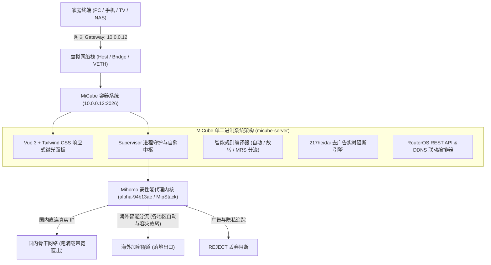

<div align="center">

  

  # 🧊 MiCube

  ### 专有高性能旁路由与多架构网关系统
  **Tailored for MikroTik RouterOS v7 · 飞牛 fnOS · PVE CT/LXC · NAS Docker**

  <p align="center">
    <a href="https://github.com/zyeyefyass/MiCube/releases"></a>
    <a href="https://github.com/MetaCubeX/mihomo"></a>
    <a href="https://hub.docker.com/r/fyasshole/micube"></a>
    <a href="https://github.com/zyeyefyass/MiCube/pkgs/container/micube"></a>
    <a href="https://golang.org"></a>
    <a href="https://vuejs.org"></a>
    <a href="#"></a>
    <a href="./LICENSE"></a>
  </p>

  <p align="center">
    <b>作者</b>: <a href="https://github.com/zyeyefyass">zyeyefyass</a> &nbsp;|&nbsp;
    <b>核心</b>: Mihomo (MetaCubeX) 最新测试版 alpha-94b13ae (MipStack + BBR) &nbsp;|&nbsp;
    <b>设计</b>: MikroTik 科技深蓝 (#001529 / #002d50 / #00d2ff)
  </p>

</div>

---

## 📖 项目简介与设计哲学 (Overview & Manifesto)

### 💡 为什么是 MiCube？—— 极客宣言与初心

> **「RouterOS 是路由系统的天花板，而 Mihomo 才是真正满血重生的 Clash！」**

很多网络玩家心中都有一个执念：主路由追求极致的电信级稳定与线速硬件吞吐，而科学旁路则渴望最灵活的分流与现代化协议支持。  
然而传统方案中，玩家们往往要在笨重臃肿的虚拟全家桶、频频死锁的防火墙脚本以及复杂的网关折返间身心俱疲。

**MiCube 的诞生，正是为了打破这种桎梏：**
- 🌾 **让普通人也能吃上饱饭**：秉持**「低配硬件高档享受」**的核心设计哲学。拒绝动辄要求 4 核 8G 的笨重运行时堆叠，采用纯自研 Go 单二进制重构，系统总内存常驻仅 **~100MB 级别**。几十块钱的二手工控机、单核 512MB 的小主机、甚至老旧家用 NAS 的边缘容器，都能轻盈驾驭，跑出满载极限性能！
- ⚡ **天花板遇上满血战神**：将**电信级路由天花板（RouterOS v7）** 与 **全协议硬件加速内核（Mihomo v1.19.32）** 深度糅合，打造真正意义上的**主旁一体（Master-Bypass Unified）** 透明旁路系统。
- 🧊 **极简开箱，主旁一体**：告别繁琐的手工 iptables 与网关死锁，开箱即用，后台 Supervisor 自愈守护，主路由负责光速转发，MiCube 负责全域智能分流。

---

### 🛡️ 为什么原生力推 WireGuard 移动端内网穿透？

在各类内网穿透工具层出不穷的今天，为什么 MiCube 依然坚持深度联动 **RouterOS 原生 WireGuard**？

1. ⚡ **内核级极速 UDP，手机全天挂载零发热**：  
   WireGuard 基于极为精简现代的密码学（ChaCha20-Poly1305），直接运行在 Linux / RouterOS 内核空间。相较于传统 OpenVPN / IPsec 或用户态穿透工具，其上下文切换与协议握手开销近乎为零，**手机在后台挂载一整天几乎零额外耗电、机身不发热**，彻底告别移动端的发热掉电梦魇。
2. 🔄 **真正的端点无状态与无感热漫游 (Connection Roaming)**：  
   WireGuard 具有天才般的无状态连接特性。当您带着手机从家中 Wi-Fi 踏出大门、切换至户外 5G 移动网络时，即使客户端公网 IP 发生突变，**底层会话依然持续保活、连接完全不断流**，实现真正丝滑的无感漫游。
3. 📱 **一键扫码，全家设备秒级安全回航**：  
   MiCube 自动深度联动 RouterOS 免费的 IP Cloud DDNS 与 WireGuard 接口，在控制面板上**一键为手机、平板或笔记本生成标准客户端配置二维码**。无需昂贵的公网固定 IP，外出打开手机 WireGuard 扫码一照，瞬间安全穿透回家中局域网，无缝直达家里的 NAS 文件、个人相册与私有服务。
4. 🌐 **外出如在家，满血继承家庭局域网去广告与智能分流**：  
   当手机连上家里的 WireGuard 隧道后，所有 DNS 与网络流量将自动汇入 MiCube 的 SmartDNS 与 **217heidai 23 万条权威去广告引擎**。出门在外、连接公共 Wi-Fi 或蜂窝网络时，依然享受家中纯净、无污染、满载极速的加速体验！

---

## 🚀 Mihomo 官方测试版内核驱动 (alpha-94b13ae · MipStack 协议栈)

MiCube 全面采用 **[MetaCubeX/mihomo](https://github.com/MetaCubeX/mihomo) 官方最新 Alpha 测试版内核（alpha-94b13ae）** 作为底层核心代理引擎，由 Go 单二进制守护进程 `micube-server` 提供企业级进程生命周期守护、配置动态编译与热重载：

- 🌐 **全协议全栈硬件加速**：完整支持 Shadowsocks、VMess、VLESS、Trojan、Hysteria 2、TUIC v5、WireGuard 等现代高性能代理协议。
- ⚡ **TUN MipStack 轻量高性能用户态协议栈 (`mips`)**：全面对齐 Mihomo 最新自研 IP 栈，纯 Go 编写、零 CGO 依赖、支持批量包处理与零拷贝复用，内存开销较 gVisor 降低 40% 以上，极度适配软路由/容器低内存环境。
- 🏎️ **原生集成 Google BBR / BBRv3 拥塞控制**：内置 `congestion-controller: bbr` 算法加速，在跨洋高丢包、大延迟长肥管道下依然实现线速满带宽吞吐。
- 🎯 **各地区自动优选与容灾故转**：实时并发测速选路（`url-test`）与健康探针故障转移（`fallback`）双模并行。
- 🗜️ **现代化 MRS 二进制规则格式**：支持高速 Meta Ruleset，23 万+ 去广告与隐私规则毫秒级检索，内存占用缩减 80% 以上。
- 🛡️ **内存软上限与防 OOM 治理**：原生注入 `GOMEMLIMIT=40MiB` 与 `GOGC=30`，杜绝软路由与容器环境下的内存溢出崩溃。

---

## 📸 核心模块实机展示与特性详解 (Features & Showcase)

### 1. 现代化微光仪表盘 · 电信级全景实时监控
深度统筹内核生命周期与系统性能，毫秒级响应，总内存开销仅 **~90MB** 级别。

<p align="center">
  
</p>

- ⚡ **电信级宿主平台识别**：智能探查并展示 RouterOS v7.x、Linux VM 或 NAS Docker 官方纯矢量 Logo 识别徽章；
- 📈 **60fps 高精度平滑网络流速波形**：实时呈现全屋设备的上行、下行瞬时流量与活跃连接链路；
- 🛡️ **Supervisor 守护中枢**：支持一键启动、停止、热重载与守护进程崩溃自愈，开机自动托管。

---

### 2. 订阅管理与出口策略组 · 智能选路与真实 IP 直出
分流规则彻底摆脱传统手写配置痛点，可视化轻松掌控复杂分流策略。

<p align="center">
  
</p>

- 🎯 **各地区自动优选与容灾故转**：支持按业务目标指定出口策略组，提供 **各地区最低延迟（自动）** 与 **健康探针容灾（故转 / 故障转移）** 下拉菜单快速选择；
- 🔄 **微动模式切换**：支持 `✎ / ▾` 微动按钮快速切换预设下拉与自定义手动输入，兼具易用性与扩展性；
- 🌐 **国内直连显示真实 IP（黑科技）**：智能将国内大厂与局域网流量彻底绕过 Fake-IP 映射池，由国内 DNS 直接解析真实公网 IP 直连直出，**不占内核 CPU，跑满满载带宽**，BT/PT 与游戏联机零阻碍；
- ⚡ **海外 QUIC (UDP 443) 优化**：智能阻断劣质 UDP，迫使 YouTube / Chrome 回退至 TCP TLS，享受节点 BBR 算法强力加速，彻底消除 4K 缓冲转圈与丢包。

---

### 3. 217heidai 全网去广告与隐私防追踪 · 毫秒级直接丢弃
集成全网权威反追踪规则库，还家庭一个清爽无污染的网络空间。

<p align="center">
  
</p>

- 🛑 **23.3 万条权威规则秒级检索**：集成 217heidai 权威二进制规则集（`adblockmihomo.mrs`）与 MetaCubeX 隐私库，加载逾 **233,481 条** 过滤规则；
- 📊 **今日拦截计数与全局开关**：一键开启全屋防护，毫秒级 REJECT 阻断，零带宽损耗；
- 🔍 **实时已拦截域名与请求流监控**：精准记录全屋手机（如 iPhone 16）、电脑（MacBook Pro）、电视（小米电视）触发的广告推送与隐私遥测，清晰可查。

---

### 4. WireGuard 移动端内网穿透 · 外出手机一键扫码回航
将 RouterOS 电信级底层能力与现代轻量级 UDP 穿透协议深度打通。

<p align="center">
  
</p>

- 📱 **一键生成手机 WireGuard 二维码**：无需繁琐手动抄写密钥与 Endpoint，点击「扫码配置」手机一照即刻配对；
- 🔄 **端点无状态与无感热漫游**：外出从 Wi-Fi 切换到 5G 移动蜂窝网络，IP 突变会话不断流；
- 🔋 **内核级 UDP 极速响应**：手机全天挂载后台几乎零额外耗电、机身不发热；
- 🛡️ **外出如在家，继承全局去广告与分流**：在外连接公共 Wi-Fi 时，所有流量安全回航经由家中 MiCube 处理，外出同样享受纯净高速网络。

---

### 5. 双模极客响应式设计 · 手机移动端极致优化
无论在大屏电脑前还是躺在沙发握着手机，都能获得丝滑一致的掌上运维体验。

<p align="center">
  
</p>

- 📱 **灵动微光顶栏**：Mini 胶囊实时展现当前状态、运行时间与宿主平台徽章；
- 🎛️ **极客悬浮毛玻璃 Dock 栏**：专为移动端单手操作优化，完美避开 iPhone 刘海屏与底栏 Home 条；
- 💻 **全功能不阉割**：手机端直接支持切换分流模式、测速选路、查看拦截流与重启核心。

---

## 🏛️ 系统架构 (Architecture)



---

## 🧭 【小白必读】旁路由无感安全接入三步法则

> [!IMPORTANT]
> 很多新手最担心“一改网关，全家断网”。请牢记以下**安全部署三法则**，100% 避免误操作：
> 1. **先起容器，再进后台**：先按下方对应系统教程启动容器，在浏览器中打开 `http://你的设备IP:2026`，看到蓝色控制台且左上角显示**「核心运行中」（绿灯）**。
> 2. **先导节点，测通延迟**：在【节点选择】页面点击右上角导入你的订阅链接，点击“测速”，确保节点列表出现绿色延迟数字。
> 3. **单机验证，绝不断网**：先拿自己的一台手机或电脑，手动修改该设备的网关与 DNS 为 MiCube 的 IP 测试。验证 YouTube / Google / 微信完全秒开无误后，再决定是否在主路由器 DHCP 中全局应用！

---

## 🚀 新手极简部署指南 (Step-by-Step Installation)

支持主流 NAS 与软路由系统，镜像已支持 **AMD64 (x86_64) 与 ARM64 双架构**：
- **Docker Hub 公共镜像（全平台搜索通用）**：`fyasshole/micube:latest`
- **GitHub GHCR 备用镜像**：`ghcr.io/zyeyefyass/micube:latest`
- **离线安装包（无需外网）**：前往 [Releases 页面](https://github.com/zyeyefyass/MiCube/releases) 下载纯 `.tar` 离线镜像包：`MiCube-amd64.tar` 或 `MiCube-arm64.tar`（无需繁琐二次解压，直接导入）。

---

### 🌟 方案一：飞牛私有云 (fnOS) Docker 部署教程

> [!TIP]
> 推荐直接使用 **方法 A（图形化界面）**，全程鼠标点击，不需敲击任何一行黑底代码！

#### 方法 A：飞牛桌面【Docker 容器】图形界面部署（纯小白首选）

1. **下载或导入镜像（二选一）**：
   - **在线搜索拉取**：打开飞牛桌面 -> 进入【Docker】应用 -> 点击左侧【镜像仓库】 -> 顶部搜索栏输入 **`fyasshole/micube`** -> 点击搜索并下载（版本选择 `latest`）。
   - **离线本地导入**：若 NAS 下载外网较慢，可在电脑前往 [Releases 页面](https://github.com/zyeyefyass/MiCube/releases) 直接下载 **`MiCube-amd64.tar`**；在飞牛 Docker【本地镜像】界面点击【导入】，直接选择该 `.tar` 文件上传（免去二次解压烦恼！），1 秒极速导入！
2. **创建容器**：
   - 在【本地镜像】列表中找到下载好的 `micube`，点击右侧的【创建容器】。
   - **容器名称**：填写 `micube`；
   - **自动重启**：勾选【开机自动启动】。
3. **⚠️ 关键设置（最核心两步，务必勾选正确）**：
   - **网络设置**：网络模式下拉选择 **`host`（主机网络模式）**。*(注意：千万不要选 bridge，否则局域网无法接入)*
   - **高级权限**：勾选 **【以高权限运行容器】（Privileged 模式）**。*(注意：必须勾选，用于系统加载 TUN 虚拟网卡)*
4. **存储空间映射**：
   - 点击添加文件夹映射（本地路径可自由存放在您的任意共享文件夹中，例如 `docker/micube`）：
     - 本地路径选择：`docker/micube/data` ➔ 容器路径填写：`/opt/MiCube/data`
     - 本地路径选择：`docker/micube/etc` ➔ 容器路径填写：`/opt/MiCube/etc`
5. **启动与进入控制台**：
   - 点击【完成】，容器即刻启动。
   - 打开电脑或手机浏览器，访问：**`http://你的飞牛IP:2026`**  
     *(例如飞牛后台是 192.168.1.5:5678，则输入 `http://192.168.1.5:2026`)*，立即进入控制台！

---

#### 方法 B：飞牛【项目 (Compose)】一键部署

1. 打开飞牛【Docker】-> 点击左侧【项目】-> 点击【创建项目】；
2. 项目名称填写 `micube`，在配置文本框中粘贴如下代码：

```yaml
version: '3.8'

services:
  micube:
    image: fyasshole/micube:latest
    container_name: micube
    restart: always
    network_mode: host
    privileged: true
    devices:
      - /dev/net/tun:/dev/net/tun
    volumes:
      # 采用相对路径，飞牛会自动在项目所在目录创建 data 与 etc 文件夹，绝对不会路径报错！
      - ./data:/opt/MiCube/data
      - ./etc:/opt/MiCube/etc
    environment:
      - TZ=Asia/Shanghai
      - PORT=2026
```
3. 点击【构建并启动】，等待 3 秒即可完成部署。

---

### ⚡ 方案二：Proxmox VE (PVE) LXC / CT 容器极速部署

在 PVE 中采用 **LXC (CT) 容器** 运行，内存仅占 ~80MB，性能损耗为 0。

> [!WARNING]
> **PVE 新手三大避坑红线：**
> 1. 创建容器常规设置中，**必须取消勾选【无特权容器】**（即必须创建特权容器）！
> 2. 网络 IP 必须是**您家路由器的相同网段**，不要死抄！例如主路由是 `192.168.1.1`，此处可填 `192.168.1.200/24`，网关填 `192.168.1.1`！
> 3. 修改配置文件时，文件名的数字是你自己容器的 ID（例如 100 就改 `100.conf`）！

#### 步骤 1：PVE 宿主机开启 TUN 模块支持
进入 PVE 节点的【Shell】终端，粘贴执行：
```bash
# 加载 tun 模块并写入开机自启
modprobe tun
grep -q "^tun$" /etc/modules || echo "tun" >> /etc/modules
ls -l /dev/net/tun
# 显示 crw-rw-rw- 即表示宿主机已准备就绪
```

#### 步骤 2：创建特权 LXC 容器
1. PVE 网页右上角点击【创建 CT】；
2. **常规**：CT ID 记录下来（如 `108`），密码自定，**务必取消勾选【无特权容器】**；
3. **模板**：选择最新官方 `debian-12-standard` 或 `alpine-3.20` 模板；
4. **磁盘与内存**：磁盘分配 4G 即可，内存 512MB；
5. **网络**：桥接选 `vmbr0`，IPv4 填写：`你的局域网未占用IP/24`（如 `192.168.1.200/24`），网关填写主路由 IP（如 `192.168.1.1`）；
6. 完成创建，**先不要开机！**

#### 步骤 3：为容器直通虚拟网卡权限
回到 PVE 宿主机的【Shell】终端，输入编辑命令（将 `108` 替换为你的容器真实 ID）：
```bash
nano /etc/pve/lxc/108.conf
```
按下键盘方向下键滑到最底部，粘贴以下 3 行直通参数：
```ini
lxc.cgroup2.devices.allow: c 10:200 rwm
lxc.mount.entry: /dev/net/tun dev/net/tun none bind,create=file
lxc.apparmor.profile: unconfined
```
按快捷键 `Ctrl + O` 保存，回车确认，再按 `Ctrl + X` 退出编辑器。

#### 步骤 4：进入容器并启动 MiCube
1. 在 PVE 网页启动该容器，点击进入【控制台 (Console)】，输入 root 及你设定的密码登录；
2. 开启内核数据包转发并运行容器：
```bash
# 1. 开启 IPv4 转发
echo "net.ipv4.ip_forward = 1" >> /etc/sysctl.conf
sysctl -p

# 2. 安装 Docker (如已安装可跳过)
curl -fsSL https://get.docker.com | sh

# 3. 运行 MiCube 容器
docker run -d \
  --name micube \
  --restart always \
  --net host \
  --privileged \
  -v /dev/net/tun:/dev/net/tun \
  -v ./data:/opt/MiCube/data \
  -v ./etc:/opt/MiCube/etc \
  fyasshole/micube:latest
```
3. 打开浏览器访问：`http://你刚才分配给CT容器的IP:2026`（例如 `http://192.168.1.200:2026`）。

---

### 🌐 方案三：MikroTik RouterOS v7 原生容器一键部署

在 RouterOS WinBox 打开 **Terminal** 终端，将参数中的 IP 替换为您 RouterOS 的实际局域网网段执行：

```routeros
# 1. 创建专用虚拟网卡并加入默认网桥 (例如你的 ROS 网段为 192.168.88.x)
/interface/veth/add name=micube address=192.168.88.2/24 gateway=192.168.88.1
/interface/bridge/port add bridge=bridge interface=micube

# 2. 从 Release 页面下载 MiCube-amd64.tar (x86) 或 MiCube-arm64.tar (ARM) 上传至 ROS 磁盘
# 在 WinBox -> Files 确认磁盘挂载名称 (通常为 disk1 或 usb1)
/container/config/set tmpdir=disk1/pull
/container/add file=disk1/MiCube-amd64.tar interface=micube root-dir=disk1/micube \
    envlist="" hostname=MiCube logging=yes start-on-boot=yes

# 3. 启动并运行
/container/start [find where interface=micube]
```

访问地址：👉 **`http://192.168.88.2:2026`**

---

### 💻 方案四：通用 Linux 服务器 / 虚拟云主机 Docker 部署

```bash
docker run -d \
  --name micube \
  --restart always \
  --net host \
  --privileged \
  --cap-add NET_ADMIN \
  --cap-add NET_RAW \
  -v /dev/net/tun:/dev/net/tun \
  -v ./data:/opt/MiCube/data \
  -v ./etc:/opt/MiCube/etc \
  -e TZ=Asia/Shanghai \
  -e PORT=2026 \
  fyasshole/micube:latest
```

---

## 📱 终端设备如何接入旁路由？（手把手教学）

假设您的主路由器 IP 为 `192.168.1.1`，MiCube 运行在 `192.168.1.200`：

### 1. 苹果手机 / iPad 设置方法：
1. 打开【设置】->【无线局域网】-> 点击已连接 Wi-Fi 旁边的 **ⓘ 图标**；
2. 往下拉找到【配置 IP】，将“自动”改为**“手动”**：
   - **IP 地址**：填写 `192.168.1.88`（与原 Wi-Fi 相同网段的未占用 IP）
   - **子网掩码**：`255.255.255.0`
   - **路由器**：填写 **`192.168.1.200`**（重点！改为 MiCube 的 IP）
3. 找到【配置 DNS】，将“自动”改为**“手动”**：
   - 删除原有 DNS，新增一条：**`192.168.1.200`**（重点！改为 MiCube 的 IP）
4. 点击右上角【存储】，打开 Safari 浏览器访问 Google 或 YouTube，秒开即代表接入成功！

### 2. 安卓手机 / 鸿蒙系统设置方法：
1. 进入【设置】->【WLAN】-> 长按当前连接的 Wi-Fi -> 选择【修改网络】；
2. 展开【高级选项】->【IP 设置】由 DHCP 改为 **静态**：
   - **网关**：填写 **`192.168.1.200`**（MiCube 的 IP）
   - **DNS 1**：填写 **`192.168.1.200`**
3. 保存即可。

### 3. Windows 电脑设置方法：
1. 打开【控制面板】->【网络和共享中心】-> 点击当前连接的【以太网】或【WLAN】；
2. 点击【属性】-> 双击【Internet 协议版本 4 (TCP/IPv4)】；
3. 选择“使用下面的 IP 地址”：
   - **默认网关**：填写 `192.168.1.200`
   - **首选 DNS 服务器**：填写 `192.168.1.200`
4. 点击确定保存。

### 4. 全局无感接入（全家设备免配置）：
在您的一台手机或电脑按上述步骤单机验证完全正常后，打开主路由后台（如华硕、爱快、OpenWrt、小米）：
- 进入【局域网 (LAN) 设置】/【DHCP 服务】；
- 将 DHCP 下发的 **网关** 与 **主 DNS** 直接修改为 `192.168.1.200` 并保存；
- 全家所有设备只需断开 Wi-Fi 重新连接，无需任何设置，即可全自动享受满载透明分流与去广告！

---

## ❓ 常见新手排障问答 (Troubleshooting FAQ)

<details>
<summary><b>Q1: 容器启动了，为什么浏览器打不开 :2026 后台？</b></summary>
<br/>
1. 请检查创建容器时<b>网络模式是否选为了 host</b>。如果误选为 bridge，容器无法绑定主机端口；<br/>
2. 检查宿主机防火墙是否放行了 2026 端口；<br/>
3. 检查浏览器输入的 IP 是否是 NAS 或宿主机的真实局域网 IP。
</details>

<details>
<summary><b>Q2: 手机改了网关后，国内微信和网页正常，但打不开国外网站？</b></summary>
<br/>
1. 打开 MiCube 后台，点击左侧【节点选择】；<br/>
2. 确认是否已成功导入了有效的订阅节点，并点击“测速”，确保节点后方有绿色的延迟数字；<br/>
3. 确认左上角的「核心运行中」绿灯常亮。
</details>

<details>
<summary><b>Q3: 国内直连是否会消耗旁路由的 CPU？微信发图片会不会卡？</b></summary>
<br/>
完全不会！MiCube 拥有独创的<b>国内真实公网 IP 直连直出机制</b>，微信、淘宝、抖音、B站等国内大厂流量由 SmartDNS 直接解析为真实公网 IP，完全绕过 Fake-IP 池，不走内核加解密，直接由物理网卡线速转发，跑满满载带宽且 CPU 占用近乎为 0。
</details>

---

---

## 🔄 版本更新日志与迭代历程 (Changelog)

### 🧊 Test V0.6 (2026-10-15) · RouterOS 原生联动对齐、全自动策略路由下发与灾备系统
- 🛡️ **RouterOS 防火墙与策略路由全自动体检与一键配置**：
  - 新增专用策略路由诊断矩阵，自动体检 `/routing/table`（`micube` 表）、默认网关路由（`0.0.0.0/0 via MiCube`）、Mangle prerouting/redirect 标记（`mark: 0x2026`）、防死锁回环白名单（`MICUBE_BYPASS`）以及严格防 DNS 泄露规则（53 端口重定向与 SERVFAIL 阻断）。
  - 支持在 Web 面板直接点击「⚡ 一键配置到 RouterOS」通过 REST API 全自动下发就绪，无需手动操作 WinBox。
- ⚡ **取消复制终端命令行，全面升级为 REST API 原生直通**：
  - 取消弹窗强制要求用户复制 WinBox 脚本的旧操作，WireGuard 服务端、客户端 Peers 以及策略路由全部由后台 REST API 原生直通；
  - 依然贴心保留「WinBox 终端脚本 (备用)」一键复制选项，供无 REST API 环境手工审计备用。
- 📱 **WireGuard 与 RouterOS 实时对齐矩阵**：
  - 新增 WireGuard 接口、IP 网段、UDP 防火墙端口、IP Cloud 动态域名及所有 Peer 授权密钥的实时对齐检查卡片与一键对齐按钮；
  - 支持已授权客户端 Peer 在线重命名（`✏️ 改名`），名称自动同步至 RouterOS comment 备注。
- 🌏 **严格 7 大标准地区分组与零乱码保证**：
  - 节点地区分组严格限定为「香港、台湾、新加坡、韩国、日本、美国、其它」，其余所有未知地区节点一律自动汇入「其它」，彻底规避杂乱自定义分组；
  - 核心订阅编译器注入 UTF-8 严格清洗，全栈 HTTP/JSON/静态文件响应注入 `charset=utf-8`，彻底消除不同操作系统下的字符乱码问题。
- 💾 **系统配置全量备份与一键恢复 (Backup & Restore)**：
  - 新增系统全量配置导出与恢复引擎，支持一键导出包含节点订阅、分流规则、WireGuard 服务端与 Peer 私钥、RouterOS 凭据与设备备注的 `.json` 灾备文件；
  - 支持在任何全新或迁移设备上一键导入秒级还原，零数据丢失。
- 🏷️ **局域网设备按 IP 与 MAC 自定义备注**：
  - 设备管理与实时会话中全面支持按设备 IP 地址或 MAC 物理地址绑定友好名称（如“客厅电视”、“NAS”），多视图统一联动呈现。
- 📋 **HTTP 局域网剪贴板复制 100% 容错回退机制**：
  - 彻底解决现代浏览器在非安全上下文（纯 HTTP 局域网 IP）下 `navigator.clipboard` 被静默拦截的问题，通过兼容选择区回退机制保证一键复制成功率 100%。

### 🧊 Test V0.5 (2026-10-15) · 极速首包 DNS 竞速、升级预检自愈与全平台一键部署
- ⚡ **DNS 极速首包混合并发竞速**：在 `nameserver` 与 `direct-nameserver` 中将顶级纯 IP UDP DNS（`223.5.5.5`, `119.29.29.29`）与加密 DoH 深度融合，纯 UDP 负责 2~5ms 闪电首包响应，DoH 负责防劫持加密保底，实现真正的超低延迟立体并发竞速。
- 🛡️ **更新包 ELF 完整性与尺寸预检**：升级引擎引入 Pre-Flight 预检机制，升级二进制下载完成后先进行最低尺寸（5MB）与 Linux ELF Magic Header 签名校验，校验通过才执行原子替换，彻底规避因网络波动下载残缺文件导致服务瘫痪。
- 🔄 **原子级平滑备份与回滚**：二进制覆盖前自动备份为 `micube-server.bak`，保留回退锚点，全流程零人工干预自愈。
- 🚀 **新增全自动 1-Click 极速部署脚本 (`scripts/install.sh`)**：全自动识别 CPU 架构（amd64 / arm64）、探查当前物理网卡与网关、开启内核 IPv4 转发并自动拉起 MiCube 高性能容器，飞牛 fnOS、PVE、通用 Linux 一键秒级上车！

### 🧊 Test V0.4 (2026-10-15) · MipStack 协议栈与全状态自愈升级
- 🚀 **TUN 协议栈全面升级为 MipStack (`mips`)**：全面对齐 Mihomo 最新 Alpha 核心协议规范，TUN 栈由 `mixed` 升级为专有轻量高性能协议栈 `mips`，原生集成 Google BBR / BBRv3 拥塞控制算法，大幅降低内存开销与 GC 停顿，彻底杜绝容器低内存下的网络波动与崩溃。
- ⚡ **上游 DNS 并发竞速全链路覆盖**：国内 DoH 双擎竞速（阿里 vs 腾讯）、海外 DoH 双雄竞速（Cloudflare vs Google）、未命中域名跨域并发交叉竞速与防污染兜底、出站直连 UDP/DoH 混合竞速，并强制注入 `tcp-concurrent: true` 开启 TCP 多 IP 极速并发握手。
- 🖥️ **宿主平台与系统版本完整呈现**：彻底解决平台徽章与版本号字符截断问题，左侧栏 Hero 徽章、移动端顶栏与仪表盘平台卡片完整呈现宿主准确版本（如 `RouterOS v7.24.5 (stable)`）。
- 🔄 **全站版本号动态响应绑定**：彻底移除模板中历史遗留的静态写死版本占位符，面板顶部、侧边栏底部、移动端抽屉全站统一动态响应绑定 `Test V0.4`。
- 🛡️ **核心启动安全回滚自愈机制**：启动守护脚本 `micube-ctl` 新增安全回退保护：当主配置文件解析异常导致核心启动失败时，自动回滚至 `config.yaml.bak` 备份配置拉起核心，防止错误配置导致无法进入管理面板。
- 🛠️ **双向一键强制自愈**：系统设置中新增「🔄 强制修复/重装面板」与「🔄 强制重拉内核」按钮，支持在网络波动中断时一键无损修复覆盖。
- 🐳 **RouterOS 容器自愈增强**：一键安装脚本 `install-routeros.rsc` 默认加入 `restart-policy=always`，确保护航容器在宿主重启后自动自愈恢复。

### 🧊 Test V0.3 (2026-10-15) · Alpha 内核跟踪与 OTA 在线热升级
- ⬆️ **全面集成 OTA 在线热升级引擎**：支持面板服务与 Mihomo 内核一键平滑热升级，自动更新 `meta.json` 并保持配置持久化。
- 🔍 **Mihomo Alpha 测试版全自动跟踪**：升级引擎支持跟踪 `Prerelease-Alpha` 语义版本并获取直链下载。
- ⚡ **KSpeeder 多源镜像加速**：国内环境拉取 GitHub 资源自动并发优选高速镜像源。

### 🧊 Test V0.2 (2026-10-15) · 多架构适配与 WireGuard 原生联动
- 📱 **RouterOS 原生 WireGuard 一键扫码**：自动探测 RouterOS IP Cloud DDNS，一键生成标准手机穿透二维码。
- 🗜️ **217heidai MRS 高速去广告**：集成 23.3 万条权威广告与隐私追踪过滤规则，毫秒级 REJECT 阻断。
- 🌐 **国内真实 IP 直连直出**：国内流量与局域网彻底绕过 Fake-IP 映射池，由国内 DNS 解析真实公网 IP 直连直出。

### 🧊 Test V0.1 (2026-10-14) · 官方首发版本
- 纯 Go 单二进制单体架构 `micube-server`，内存占用 ~90MB 级别。
- 专为 MikroTik RouterOS v7 设计的科技深蓝毛玻璃 UI。

---

## 📜 版权与开源许可证声明 (License & Copyright)

本项目的服务端二进制程序（`micube-server`）、系统架构体系及专属 WebUI 控制台属于 **zyeyefyass** 拥有 100% 独立知识产权的专有闭源成果。

- **个人用户**：享有完全免费用于个人家庭路由与 NAS 设备之权利；
- **商用与二次分发**：严禁未经书面许可用于任何商业售卖、付费中转引流、反编译破解或贴牌篡改；
- 详情请查阅 [LICENSE](./LICENSE) 与 [DECLARATION.md](./DECLARATION.md)。

---

<div align="center">
  <b>MiCube · 专有高性能旁路由系统 · Test V0.6</b><br/>
  Crafted with ❤️ by <a href="https://github.com/zyeyefyass">zyeyefyass</a>
</div>
