> [!IMPORTANT]
> # 📢 MiCube & SingCube 归档与演进公告：当“宗教辩论”催生出的终极魔方
>
> 大家好！
>
> 首先，向一直以来把玩 **MiCube**（Mihomo 内核）与 **SingCube**（sing-box 内核）的每一位硬核玩家致以最诚挚的谢意。
>
> 回顾过去这段时间，我的朋友圈简直变成了大型**“软路由当代宗教辩论修罗场”**：
>
> * ☕ **Mihomo 派信徒**：天天端着保温杯，笃信世间万物皆可被复杂的嵌套策略组与几十万条正则规则统治；手里握着几百个备用节点，选路容差精确到毫秒，眼里容不下一粒沙子：*“没有精细化分流与故障转移的网关，是没有灵魂的算力废铁！”*
> * ⚡ **sing-box 派极速党**：信奉极致的内存唯快不破、纳秒级的冷启速度与最前沿的现代化协议；在他们眼里，配置里多占用 1MB 内存都是对内心的背叛：*“能用极简 JSON 和纯粹内核搞定的事，为什么要套娃十层 YAML？”*
>
> 两拨朋友在群里和朋友圈里为了“到底谁才是软路由真神”吵得面红耳赤，辩论激烈程度差点连路由器的散热片都给掀翻了。
>
> 作为这两个项目的维护者，我当时陷入了沉思：**我们为什么要逼大家做选择题？成年人的世界，难道不是应该——“我 全 都 要”吗？！**
>
> 为了彻底平息两派玩家的“内耗”，让大家放下键盘开心喝茶，我们索性把这两个项目原地进行**基因级融合与全面重构**，正式推出跨世代终极旗舰项目——**CubeX（极光魔方）**！
>
> ---
>
> ### 🚀 我们在 CubeX 中终结了什么，又带来了什么？
>
> 1. **⚡ 双擎共生，零断流毫秒级热切（Make-Before-Break）**  
>    在 CubeX 中，Mihomo 与 sing-box v1.14.3+ 融为一体。顶栏常驻毫秒级切换胶囊，不重建防火墙、不断开存量长连接，选中的出口节点状态自动无缝手递手（Handoff）。不仅如此，我们还顺手做了一个**「双核同节点 AB 竞技场」**：同一节点同时让 M 核与 S 核同台狂飙，TCP 握手、TLS 开销与内存占用实时同屏对决，让数据说话！
>
> 2. **🖥️ 宿主机底座全面打通，智能自适应识别**  
>    拒绝割裂！CubeX 彻底告别繁琐代码，全自动嗅探底层宿主系统：
>    * 🔷 **MikroTik RouterOS v7** 容器联动（自动探查 IP Cloud 免费动态域名、自动下发策略路由表 `table 8228`、Netwatch 0秒逃生）
>    * 🟢 **飞牛 fnOS 专属底座**（Debian 12 内核优化）
>    * 🟠 **Proxmox VE (PVE)** LXC / 💻 **通用 Linux Docker**  
>    内核数据包转发（`ip_forward=1`）与防火墙放行规则支持**一键智能打通**，无论新手还是老鸟，插上电就是终极旁路由。
>
> 3. **📡 WireGuard 穿透双端硬件级对齐 & 设备分流矩阵**  
>    外网手机官方 WireGuard App **一键扫码秒连家庭内网**，内置 5 项对齐矩阵体检；针对局域网特定终端（家庭影院蓝光机、PT 下载机、Apple TV、PS5），提供直观的三段式胶囊滑块：  
>    `🟢 智能规则分流` ⇄ `🔵 底层直连绕过 (专为蓝光机 SMB1 准备)` ⇄ `🟣 绑定死特定出口`。
>
> 4. **🛡️ 217heidai 权威规则与严格 0 明文 DNS 泄露**  
>    内置 233,481 条高精度离线 MRS 去广告规则集，Fake-IP 智能剥离，国内真实公网 IP 直连直出，杜绝 ISP 劫持与 DNS 污染。
>
> 5. **🚀 四维版本在线热更矩阵**  
>    拒绝繁琐手动敲命令行：**CubeX 主控守护、Mihomo 内核、sing-box 内核、全量 Geo/MRS 规则数据库、宿主机底座系统包**，全部支持在面板上一键检测与无损热更。
>
> ---
>
> ### 📌 后续归档安排与全新起航
>
> * 📦 **状态变更**：本仓库自即日起正式进入**只读归档状态（Archive / Read-only）**，历史代码与讨论将永久保留以供查阅。
> * 🌌 **全新起航**：所有后续功能演进、Bug 修复及镜像构建，均已全面转移至全新合体主仓库：  
>   👉 **[zyeyefyass/CubeX (GitHub)](https://github.com/zyeyefyass/CubeX)**
>
> 感谢每一位朋友在 MiCube 和 SingCube 探索期给予的包容、批评与宝贵建议。没有你们当年的激烈争论和极致挑剔，就不会有今天这颗毫无妥协的 CubeX。
>
> “圣战”已经结束，魔方已经拼好。欢迎移步新家，继续回来**“开箱”与“开机”**！
>
> —— **zyeyefyass & CubeX 核心团队**  
> *2026年10月*
>
> ---

<div align="center">

  

  # 🧊 MiCube

  ### 专有高性能旁路由与多架构网关系统
  **Tailored for MikroTik RouterOS v7 · 飞牛 fnOS · PVE CT/LXC · NAS Docker**

  <p align="center">
    <a href="https://github.com/zyeyefyass/MiCube/releases"></a>
    <a href="https://github.com/MetaCubeX/mihomo"></a>
    <a href="https://hub.docker.com/r/fyasshole/micube"></a>
    <a href="https://github.com/zyeyefyass/MiCube/pkgs/container/micube"></a>
    <a href="https://golang.org"></a>
    <a href="https://vuejs.org"></a>
    <a href="#"></a>
    <a href="./LICENSE"></a>
  </p>

  <p align="center">
    <b>作者</b>: <a href="https://github.com/zyeyefyass">zyeyefyass</a> &nbsp;|&nbsp;
    <b>核心</b>: Mihomo (MetaCubeX) 最新测试版 alpha-94b13ae (MipStack + BBR) &nbsp;|&nbsp;
    <b>设计</b>: MikroTik 科技深蓝 (#001529 / #002d50 / #00d2ff)
  </p>

</div>

---

## 📖 项目简介与设计哲学 (Overview & Manifesto)

### 💡 为什么是 MiCube？—— 极客宣言与初心

> **「RouterOS 是路由系统的天花板，而 Mihomo 才是真正满血重生的 Clash！」**

很多网络发烧友心中都有一个执念：主路由追求磐石般的系统稳定性与线速硬件吞吐，而旁路由则渴望最灵活的分流与现代化协议支持。  
然而传统方案中，玩家们往往要在笨重臃肿的虚拟全家桶、频频死锁的防火墙脚本以及复杂的网关折返间身心俱疲。

**MiCube 的诞生，正是为了打破这种桎梏：**
- 🌾 **让普通人也能吃上饱饭**：秉持**「低配硬件高档享受」**的核心设计哲学。拒绝动辄要求 4 核 8G 的笨重运行时堆叠，采用纯自研 Go 单二进制重构，**系统总内存常驻仅 50MB 出头**（实机实测常驻仅约 52MB！安装包单二进制仅 10MB 出头，较传统旁路由节省 80% 内存）。几十块钱的二手工控机、单核 512MB 的小主机、甚至老旧家用 NAS 的边缘容器，都能轻盈驾驭，跑出满载极限性能！
- ⚡ **硬核标杆遇上满血战神**：将**专业路由硬核标杆（RouterOS v7）** 与 **全协议硬件加速内核（Mihomo v1.19.32）** 深度糅合，打造真正意义上的**主旁一体（Master-Bypass Unified）** 透明旁路系统。
- 🧊 **极简开箱，主旁一体**：告别繁琐的手工 iptables 与网关死锁，开箱即用，后台 Supervisor 自愈守护，主路由负责光速转发，MiCube 负责全域智能分流。

---

### 🛡️ 为什么原生力推 WireGuard 移动端内网穿透？

在各类内网穿透工具层出不穷的今天，为什么 MiCube 依然坚持深度联动 **RouterOS 原生 WireGuard**？

1. 🚫 **彻底告别公网 IPv4 焦虑，告别运营商内网限制**：  
   如今家用宽带绝大部分被困在运营商的大内网（CGNAT / NAT444）中，想要公网 IPv4 往往需要昂贵资费或专线。WireGuard 深度配合 RouterOS 原生免费的 IP Cloud DDNS 或 IPv6 端点，**无需公网 IPv4 地址即可瞬间建立点对点安全隧道**，让内网穿透不再受制于运营商！
2. 🛡️ **彻底杜绝暴露内网 IPv6 的巨大安全风险（全屋设备绝对隐身）**：  
   很多新手获取了公网 IPv6 后，兴奋地将家里的 NAS、PC、摄像头直接开启 IPv6 对外开放——这是极度危险的“裸奔”行为！全世界的自动化扫描器与黑客脚本每天 24 小时在全网狂扫暴露的 IPv6 设备（勒索病毒、密码爆破、Web 漏洞入侵防不胜防）。  
   **WireGuard 是唯一的金牌安全护盾**：全屋所有的 NAS、电脑、摄像头等私有设备**无需对外暴露任何独立的 IPv6 地址或端口，在互联网上完全隐身**！全家仅有 RouterOS 上由强密码学签名保护的单个 UDP 端口作为唯一安全入口，外界没有正确密钥的探测包在底层直接被静默丢弃（Silent Drop），公网扫描如同面对一堵死黑洞，杜绝任何攻击面！
3. 🏠 **三层全网段直通，真正穿透整个家庭局域网 (Full-Subnet)**：  
   传统的 FRP、DDNSTO 等工具只能实现“单端口映射”（映射一个 Web 端口就要配置一次，繁琐脆弱且无法支持非 HTTP 协议）。而 WireGuard 建立的是**完整的三层网络隧道**：手机一旦连上，就像拉了一根无形的高速物理光纤直接插入家里的主交换机！无需逐个端口配置，**瞬间穿透整个家庭局域网（`192.168.x.0/24`）**：NAS 文件共享（SMB / WebDAV）、远程桌面（RDP / VNC）、打印机、Home Assistant 智能家居、软路由后台随时秒级直达！
4. 💰 **永久 100% 完全免费，绝无第三方限速与隐私窥探**：  
   商业穿透工具（如蒲公英、花生壳、各类内网穿透 SaaS）不仅有高昂的月费门槛，而且往往限制 1~2Mbps 的蜗牛带宽、限制连接设备数量，数据还要经过第三方商业服务器中转。WireGuard + RouterOS 是 100% 纯自研与原生的底层方案，**零月租、零费用**，直接跑满您家庭宽带的物理上行速率上限（无论多少兆宽带均可满载跑满物理上限，外出串流 4K 原盘毫无卡顿）！
5. ⚡ **内核级极速 UDP，手机全天挂载零发热**：  
   WireGuard 基于极为精简现代的密码学（ChaCha20-Poly1305），直接运行在 Linux / RouterOS 内核空间。相较于传统 OpenVPN / IPsec 或用户态穿透工具，其上下文切换与协议握手开销近乎为零，**手机在后台挂载一整天几乎零额外耗电、机身不发热**，彻底告别移动端的发热掉电梦魇。
6. 🔄 **真正的端点无状态与无感热漫游 (Connection Roaming)**：  
   WireGuard 具有天才般的无状态连接特性。当您带着手机从家中 Wi-Fi 踏出大门、切换至户外 5G 移动网络时，即使客户端公网 IP 发生突变，**底层会话依然持续保活、连接完全不断流**，实现真正丝滑的无感漫游。
7. 🌐 **外出如在家，满血继承家庭局域网去广告与智能分流**：  
   当手机连上家里的 WireGuard 隧道后，所有 DNS 与网络流量将自动汇入 MiCube 的 SmartDNS 与 **217heidai 23 万条权威去广告引擎**。出门在外、连接公共 Wi-Fi 或蜂窝网络时，依然享受家中纯净、无污染、满载极速的加速体验！

---

## 🚀 Mihomo 官方测试版内核驱动 (alpha-94b13ae · MipStack 协议栈)

MiCube 全面采用 **[MetaCubeX/mihomo](https://github.com/MetaCubeX/mihomo) 官方最新 Alpha 测试版内核（alpha-94b13ae）** 作为底层核心代理引擎，由 Go 单二进制守护进程 `micube-server` 提供企业级进程生命周期守护、配置动态编译与热重载：

- 🌐 **全协议全栈硬件加速**：完整支持 Shadowsocks、VMess、VLESS、Trojan、Hysteria 2、TUIC v5、WireGuard 等现代高性能代理协议。
- ⚡ **TUN MipStack 轻量高性能用户态协议栈 (`mips`)**：全面对齐 Mihomo 最新自研 IP 栈，纯 Go 编写、零 CGO 依赖、支持批量包处理与零拷贝复用，内存开销较 gVisor 降低 40% 以上，极度适配软路由/容器低内存环境。
- 🏎️ **原生集成 Google BBR / BBRv3 拥塞控制**：内置 `congestion-controller: bbr` 算法加速，在跨洋高丢包、大延迟长肥管道下依然实现线速满带宽吞吐。
- 🎯 **各地区自动优选与容灾故转**：实时并发测速选路（`url-test`）与健康探针故障转移（`fallback`）双模并行。
- 🗜️ **现代化 MRS 二进制规则格式**：支持高速 Meta Ruleset，23 万+ 去广告与隐私规则毫秒级检索，内存占用缩减 80% 以上。
- 🛡️ **内存软上限与防 OOM 治理**：原生注入 `GOMEMLIMIT=40MiB` 与 `GOGC=30`，杜绝软路由与容器环境下的内存溢出崩溃。

---

## 📸 Test V0.91 五大生产力中枢实机展示与深度详解 (Features & Showcase)

MiCube Test V0.91 告别了传统面板的选项卡堆砌杂乱，根据用户心智模型与操作频次，彻底重构为 **5 大高生产力中枢**，初次上手 3 秒即可一目了然：

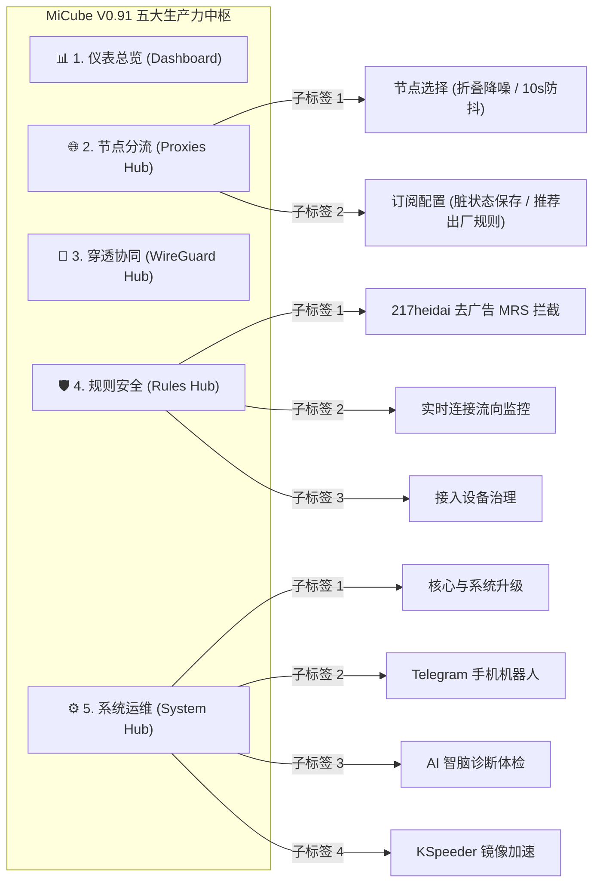

---

### 1. 📊 仪表总览 (Dashboard) · 全景网络遥测与极低内存常驻
深度统筹内核生命周期与系统性能，毫秒级响应，总内存常驻仅 **50MB 出头**（实机实测常驻仅约 52.4MB）。

<p align="center">
  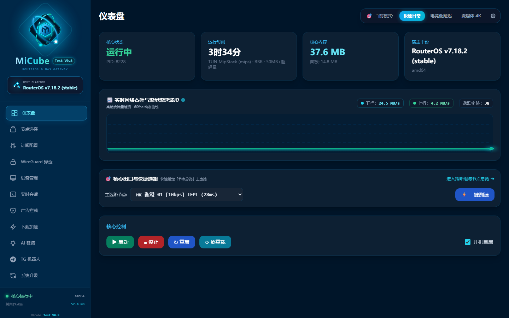
</p>

- ⚡ **原生宿主环境智能感知**：底层精准探查并展示 RouterOS v7.x、Linux VM 或 NAS Docker 官方矢量 Logo 识别徽章（如 `RouterOS v7.18.2 (stable)`）；
- 📈 **60fps 高精度平滑网络流速波形**：实时呈现全屋设备的上行、下行瞬时流量与活跃连接链路；
- 🛡️ **Supervisor 守护中枢**：支持一键启动、停止、热重载与守护进程崩溃自愈，开机自动托管。

---

### 2. 🌐 节点分流 (Proxies Hub) · 节点选择与订阅管理双核联动

#### 🎯 子标签 A：【节点选择】—— 折叠卡片降噪、三色延迟胶囊与 10 秒防抖重测
全新升级 Executive 极简视图，彻底告别数百上千节点瀑布流满屏翻找的折磨。

<p align="center">
  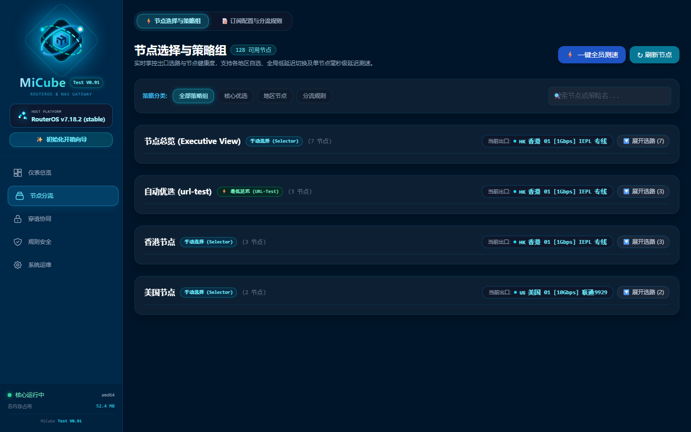
</p>

- 📦 **策略组智能折叠降噪 (0.91 重磅)**：默认收拢各分组庞大的节点列表，首行以大字体直接标示当前生效出海节点、国旗/区旗与三色延迟胶囊；支持一键展开/收起，搭配即时节点检索过滤，清爽干练；
- ⏱️ **延迟测速 10 秒防抖重测 (Anti-Flapping Retry)**：单次测速若遇偶发丢包或波动，自动触发 10 秒快速重测，杜绝瞬时抖动导致的虚假超时；
- ⚡ **毫秒级单点与并发测速**：一键刷新整组节点延迟，三色延迟胶囊（<150ms 翠绿极速 / <300ms 暖橙良好 / 超时 绯红告警）；
- 🎛️ **多层级策略组智能筛选**：支持「全部分组、自动选路 (url-test)、故障转移 (fallback)、直连、手动选择 (selector)」一键分类筛选。

---

#### 📥 子标签 B：【订阅与分流配置】—— 脏状态保存感知、一键恢复推荐规则与出口四大模式
分流规则彻底摆脱传统手写配置痛点，可视化轻松掌控复杂分流策略。

<p align="center">
  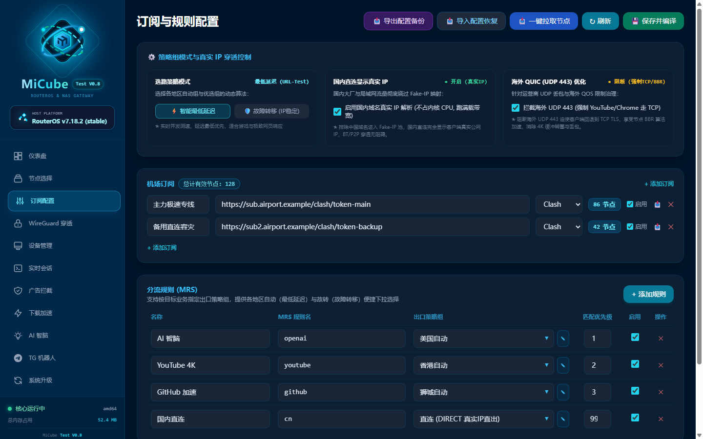
</p>

- 💾 **配置脏状态实时感知 (Dirty State Tracking · 0.91 重磅)**：
  - **有未保存改动时**：保存按钮秒级激活为**青蓝呼吸灯高亮 + 粒子发光阴影**，标示 `💾 保存并编译 (已修改)`；
  - **无未保存修改时**：按钮自动呈现低调暗态与防误触禁用 `✔ 配置已是最新`，彻底消除是否生效的焦虑。
- 🔄 **出厂推荐分流规则一键恢复 (0.91 重磅)**：无论如何调试修改规则，点击【🔄 恢复推荐规则】，随时秒级还原官方最佳 GeoIP/GeoSite/MRS 分流策略，同时**绝对安全保留**用户的机场订阅链接与 WireGuard 密钥！
- 🌐 **国内直连显示真实 IP（黑科技）**：智能将国内大厂与局域网流量彻底绕过 Fake-IP 映射池，由国内 DNS 直接解析真实公网 IP 直连直出，**不占内核 CPU，跑满满载带宽**，BT/PT 与游戏联机零阻碍；
- ⚡ **海外 QUIC (UDP 443) 优化**：智能阻断劣质 UDP，迫使 YouTube / Chrome 回退至 TCP TLS，享受节点 BBR 算法强力加速，彻底消除 4K 缓冲转圈与丢包。

---

#### 🧭 地区策略四大模式核心区别与选型决策指南 (小白必读)

| 策略模式 | 底层类型 | 工作机制 | IP 表现 | 最适业务场景 (何时选它？) | 避坑提醒 (何时慎用？) |
| :--- | :--- | :--- | :--- | :--- | :--- |
| **⚡ 地区自动**<br/>(如 `香港自动`) | `url-test`<br/>并发测速选优 | 后台每 300s 向探针并发测速，**自动选用延迟最低、起步最快的节点** | 动态漂移<br/>(随延迟切换) | **网页浏览 / 刷短视频 / 大文件下载**：YouTube、B站海外版、TikTok、普通资讯、App 更新，追求最低加载等待时间与最大吞吐带宽。 | ⚠️ 严禁用于网银与外服游戏排位，节点频繁切换会导致异地登录被风控或游戏掉线重连。 |
| **🛡️ 地区故转**<br/>(如 `香港故转`) | `fallback`<br/>主备顺序顺延 | 严格按列表顺序排队，**只要第 1 顺位节点存活，就死死锚定在该节点，绝不随意跳 IP**！主节点故障才顺延降级给下一个节点，恢复后平滑回切。 | 固若金汤<br/>(长周期绝对固定) | **AI 大模型 / 海外网银 / 远程办公**：ChatGPT、Claude、Midjourney、PayPal、Stripe、虚拟币交易所、远程 SSH / 桌面 RDP 等对 IP 漂移极度敏感的业务。 | ⚠️ 若第 1 顺位节点延迟略高，系统也不会擅自切到低延迟节点（以 IP 绝对稳定为第一优先级）。 |
| **🌐 地区容灾**<br/>(如 `香港容灾`) | `fallback`<br/>灾备应急备选 | 专用于聚合该地区的多源备用线路、低倍率保底节点或次级机场链路，独立于主生产环境之外作为二级冷备份池。 | 灾备隔离<br/>(独立备选池) | **关键时刻救命兜底**：当遇到特殊时期、主力机场大面积遭遇 DDOS 攻击、或干线海缆突发故障全线翻红时，一键将出口切至该组秒级恢复通信。 | ⚠️ 平时作为冷备用，无需挂载所有日常高带宽下载业务。 |
| **🎯 地区手动**<br/>(如 `香港手动`) | `select`<br/>人工定点锁定 | 纯静态人工单选组。用户在【节点选择】控制台选定哪个节点，流量就 **100% 且永久锁定在该节点**，系统绝不做任何自动化切换。 | 绝对人工控制<br/>(人工选定即锁定) | **外服联机电竞 / 定点流媒体解锁**：Steam / Epic / 瓦罗兰特 / Apex 游戏必须固定特定专线（如 IPLC 香港 01）；特定地区限定影视库定点解锁；网络排障抓包。 | ⚠️ 一旦该手动节点离线，系统不会自动替你切备用节点，需要人工干预重新选择。 |

---

### 3. 📱 穿透协同 (WireGuard Hub) · 30 秒自愈看门狗、一键扫码穿透与烟花监控
将 RouterOS 坚固的原生网络底座与现代轻量级 UDP 穿透协议深度打通。

<p align="center">
  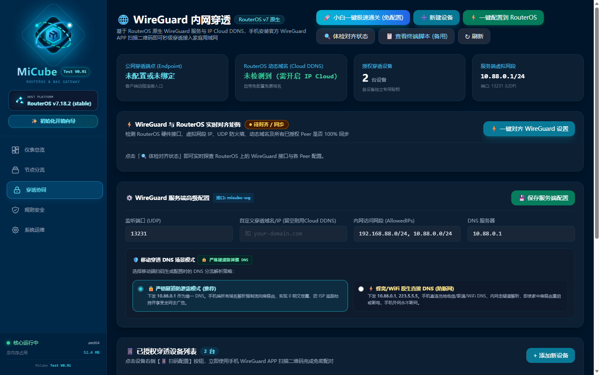
</p>

- 🛡️ **30 秒超时自愈看门狗与「以后再说」秒级跳过**：彻底攻克初始化向导在校准核心接口时遭遇的网络卡顿，超时 30 秒自动唤醒自愈选项，并随时提供【以后再说】快速跳过，绝不阻塞全局正常使用；
- 📱 **一键生成手机 WireGuard 二维码**：无需繁琐手动抄写密钥与 Endpoint，点击「扫码配置」手机一照即刻配对；
- 🎆 **握手雷达探测与绚丽烟花庆祝**：手机扫码连接成功发出首个握手包瞬间，全屏绽放绚丽粒子烟花庆祝，直观呈现双向收发流量与握手毫秒数；
- 🔄 **端点无状态与无感热漫游**：外出从 Wi-Fi 切换到 5G 移动蜂窝网络，IP 突变会话不断流；
- 🔋 **内核级 UDP 极速响应**：手机全天挂载后台几乎零额外耗电、机身不发热；
- 🛡️ **外出如在家，继承全局去广告与分流**：在外连接公共 Wi-Fi 时，所有流量安全回航经由家中 MiCube 处理，外出同样享受纯净高速网络。

---

### 4. 🛡️ 规则安全 (Rules Hub) · 217heidai 去广告拦截与全屋流向透视
集成全网权威反追踪规则库，还家庭一个清爽无污染的网络空间。

<p align="center">
  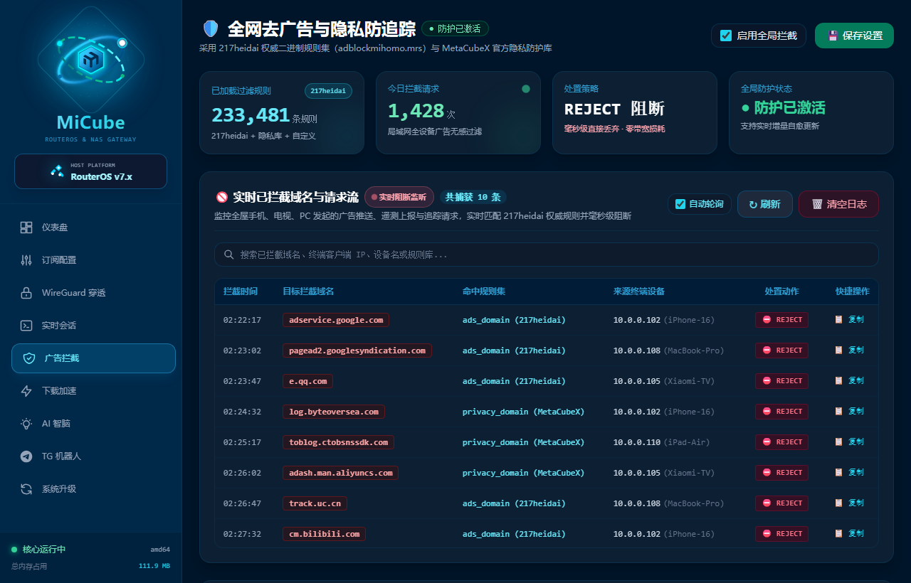
</p>

- 🛑 **23.3 万条权威规则秒级检索**：集成 217heidai 权威二进制规则集（`adblockmihomo.mrs`）与 MetaCubeX 隐私库，加载逾 **233,481 条** 过滤规则；
- 📊 **今日拦截计数与全局开关**：一键开启全屋防护，毫秒级 REJECT 阻断，零带宽损耗；
- 🔍 **实时已拦截域名与请求流监控**：精准记录全屋手机（如 iPhone 16）、电脑（MacBook Pro）、电视（小米电视）触发的广告推送与隐私遥测，清晰可查；
- 🌐 **实时流向透视与接入设备治理**：一眼看清局域网接入设备的活跃 IP、MAC 地址与分流走向。

---

### 5. ⚙️ 系统运维 (System Hub) · 固件升级、TG 机器人、AI 智脑与多源镜像加速
深度收纳软路由运维与外延赋能工具。

<p align="center">
  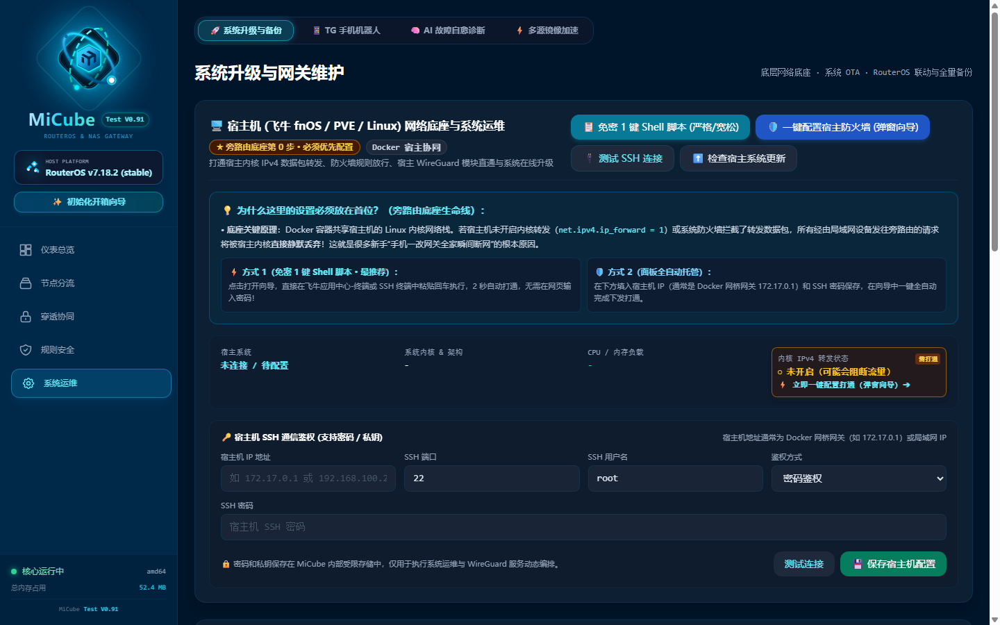
</p>

- 🔄 **核心与系统升级**：支持 RouterOS 固件自动探针、Mihomo 内核热升级、以及 MiCube 面板单二进制一键自升级；
- 📱 **Telegram 运维机器人**：外出在手机 TG 发送指令即可查询家中网络流速、切换活动节点、执行网络体检或重启核心；
- 🧠 **AI 智脑自愈体检 (OpenCode Zen / 通义千问 / DeepSeek)**：实时感知 RouterOS 拓扑与路由遥测，一键诊断网络隐患与故障自愈；
- ⚡ **KSpeeder 多源镜像加速**：专为软路由与 NAS 打造，彻底解决国内 Docker 镜像拉取失败、GitHub 资源下载超时、订阅规则更新缓慢痛点。

---

### 6. 📱 移动端专属 5 控主控坞 · 双模极客单手流畅掌控
无论在大屏电脑前还是躺在沙发握着手机，都能获得丝滑一致的掌上运维体验。

<p align="center">
  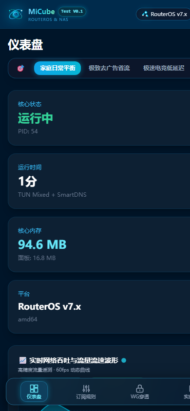
  &nbsp;&nbsp;&nbsp;&nbsp;
  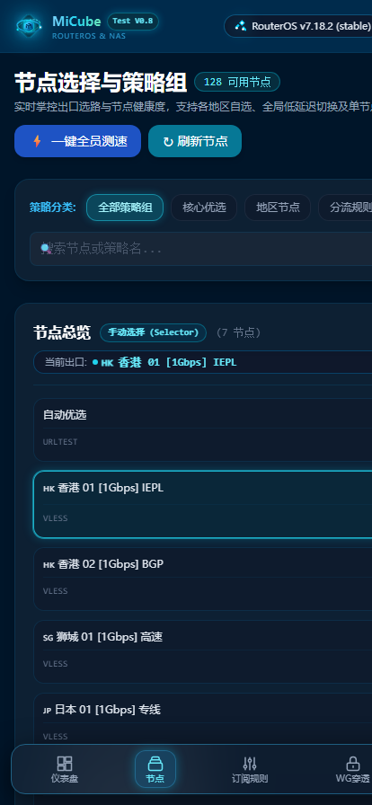
</p>

- 📱 **灵动微光顶栏**：Mini 胶囊实时展现当前状态、运行时间与宿主平台徽章；
- 🎛️ **极客悬浮毛玻璃 5 控 Dock 栏**：对齐 5 大生产力中枢，专为单手操作优化，完美避开 iPhone 刘海屏与底栏 Home 条；
- 💻 **全功能不阉割**：手机端直接支持节点测速切选、折叠展开、查看拦截流与重启核心。

---

## 🏛️ 系统架构 (Architecture)

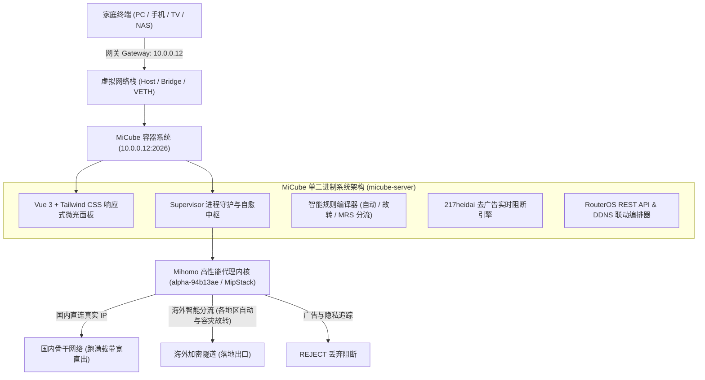

---

## 🧭 【新手必读】新装好 MiCube 从零到满血使用 5 步全流程 (首位底座与避坑)

> [!IMPORTANT]
> **很多新手最怕“一改网关，全家断网被抱怨”！**  
> 99% 的旁路由部署失败，都是因为**忽略了宿主机 Linux 内核转发（第 0 步）**或**盲目在主路由全局下发 DHCP 导致递归死锁**。  
> 为此，MiCube 创新引入了 **「✨ 全自动开箱初始化向导」** 与 **「🛡️ 宿主机底座网络与防火墙一键弹窗向导（严格/宽松双模式）」**！  
> 新装开箱进入后台，系统将**自动以弹窗向导方式引导初始化**（亦可随时点击顶部/侧栏「✨ 初始化向导」重新唤出）。  
> 只要严格遵循以下 **「第 0 步打通宿主底座与防火墙 ➔ 第 1 步导入测速 ➔ 第 2 步启动核心 ➔ 第 3 步分流选型 ➔ 第 4 步单机验证 ➔ 第 5 步全家/漫游」** 标准 5 步通关序列，纯小白也能 100% 一次成功、零断网丝滑上车！

---

### ✨ 开箱第 1 弹窗：初始化启航 · 导入备份 vs 全新配置 (2 选 1)

打开 MiCube 后台 `http://你的设备IP:2026`，系统首次进入将直接弹出**初始化向导**：

1. **📦 选项 A：导入已有系统备份 (.json · 老用户迁移 / 容灾换机)**  
   如果您之前在 MiCube 导出过 `micube-backup-*.json` 备份文件，在此直接点击上传，**1 秒内全量复原**所有机场订阅、分流规则、WireGuard 密钥与局域网设备别名，全屏烟花绽放直接满血可用！
2. **🚀 选项 B：全新极速配置 (从零到满血 · 推荐新手 / 新机部署)**  
   点击即可进入以下**标准 5 步极速通关向导**，每一步均有专属界面与一键自动化执行：

---

### 🛠️ 步骤 0：打通宿主机底座网络与系统防火墙规则（★ 首位生命线 · 一键弹窗向导）

- **💡 为什么宿主机防火墙与底座转发必须放在首位？（核心网络原理）**：  
  在 Docker 容器（飞牛 fnOS / PVE LXC / 群晖 DSM / Ubuntu 等）环境中，容器与宿主机共享底层的 Linux 内核网络栈。  
  如果宿主机内核未开启数据包转发（`net.ipv4.ip_forward = 0`）或系统防火墙 `FORWARD` 链拦截了转发数据包，**宿主机内核将直接把所有由局域网设备发往旁路由的跨网卡报文静默丢弃（Drop）**！  
  这就是为什么很多新手“手机改了网关立刻上不了网、连微信百度都打不开”的根本元凶。因此，在让任何终端设备接入旁路由之前，**必须先通过弹窗向导打通底座转发与防火墙！**

- **⚙️ 弹窗向导提供「严格」与「宽松」两种模式（按需选择）：**
  - **🟢 宽松模式 (Permissive · ★ 纯小白首选 · 开箱即通)**：  
    - **核心机制**：执行 `iptables -P FORWARD ACCEPT` 全局放行转发链，并开启全私网网段 NAT Masquerade 伪装与端口双向通畅。  
    - **优势**：100% 避免因为 Docker Bridge 虚拟网桥、多物理网卡、VLAN 标记不一致导致丢包断网，零报错、绝不卡网，即点即通！  
    - **适用场景**：飞牛 fnOS、群晖 NAS、家庭普通单局域网（`192.168.x.x` / `10.x.x.x`）。
  - **🛡️ 严格模式 (Strict · 进阶极客 / 隔离网络 · 最小特权)**：  
    - **核心机制**：保持 `iptables -P FORWARD DROP` 默认阻断，仅显式放行 `ESTABLISHED,RELATED` 状态追踪，且仅对 WireGuard 虚拟网段（`10.88.0.0/24`）与受信私网网段定向开启转发与 NAT 伪装。  
    - **优势**：严防未授权跨网段嗅探与伪造数据包，符合企业级安全审计与多 VLAN 严苛隔离规范。  
    - **适用场景**：PVE 虚拟化生产集群、公网独服、多子网 VLAN 强隔离环境。

- **⚡ 两种执行方式（弹窗内一键操作）：**
  - **方式 1（免密 1 键 Shell 脚本 · 最推荐）**：  
    在向导弹窗中选择好模式后，点击**「📋 一键复制命令」**，在飞牛应用中心自带终端、PVE Shell 或 SSH 终端中粘贴回车，2 秒自动完成永久写入 `/etc/sysctl.conf` 与防火墙持久化，**无需在浏览器网页中输入 root 密码！**
  - **方式 2（面板 SSH 一键下发）**：  
    若已在面板配置宿主机 SSH 密码，点击**「🚀 一键自动配置宿主机」**，MiCube 将通过后台 SSH 全自动下发对应模式规则，并在控制台实时呈现执行清单。
- **✅ 就绪标准**：页面与向导中「内核 IPv4 转发状态」显示为绿色 **`● 1 (已就绪)`**。

---

### 📥 步骤 1：导入订阅节点并一键测速
1. 进入 MiCube 左侧【配置管理】/【订阅管理】；
2. 粘贴您的机场服务商提供的 Clash / Mihomo 订阅链接，点击【📥 立即导入并更新】；
3. 进入左侧【节点选择】，点击右上角【⚡ 全部测速】，观察每个节点后方弹出的三色延迟胶囊（<150ms 翠绿极速 / <300ms 暖橙良好 / 超时 绯红）；
4. 确认列表中的节点存活且有效（系统已自动过滤机场公告与流量广告，节点计数 100% 真实精准）。

---

### ⚙️ 步骤 2：启动代理核心（选择 TUN MipStack 协议栈）
1. 进入左侧【仪表盘】；
2. 核心模式选择官方推荐的 **「TUN 虚拟网卡 (MipStack 混合用户态协议栈)」**（纯 Go 零 CGO、常驻内存仅 50MB 出头，内置 BBR 加速）；
3. 勾选【开机自动启动】，点击【▶ 启动核心】；
4. 观察仪表盘左上角【核心运行中】绿灯常亮，右上角平台徽章与实时流速波形正常跳动，代表 MiCube 底层虚拟网卡与透明转发已全部就绪。

---

### 🧭 步骤 3：选择业务出口分流策略（四大模式按需选型）
进入左侧【配置管理】或【节点选择】策略组，根据日常业务合理分配出口模式：
- **AI 大模型 / 海外网银（ChatGPT / Claude / PayPal）** ➔ 选用 **🛡️ 地区故转 (fallback)**：只要第 1 顺位节点存活就死死锚定，IP 长周期绝对固定，杜绝异地登录风控与封号；
- **刷短视频 / 4K 影视 / 大文件（YouTube / Netflix / TikTok）** ➔ 选用 **⚡ 地区自动 (url-test)**：系统每 300s 并发测速，自动选用当前延迟最低、带宽起步最快的满载节点；
- **国内日常流量（微信 / 淘宝 / 抖音 / 网银 / BT下载）** ➔ **完全无需操心！** MiCube 独创智能剥离技术，国内 IP 与域名 100% 绕过 Fake-IP 池，由物理网卡走真实公网 IP 直连直出，跑满宽带物理速率上限且 CPU 占用近乎为 0。

---

### 📱 步骤 4：终端设备单机验证（★ 零风险验证，绝不影响全家！）
> [!TIP]
> **千万不要一上来就去改主路由器！** 先用自己的一部手机或一台电脑单机验证，万一配置有误只需切回自动即可瞬间复原，不影响家人正常看电视刷视频。

1. 拿起您的手机，连接家中 Wi-Fi，进入 Wi-Fi 详情设为【静态 IP】/【手动】：
   - **IP 地址**：保持原 IP 不变（如 `192.168.1.88`）；
   - **子网掩码**：`255.255.255.0`；
   - **路由器 / 默认网关**：修改为 **`MiCube 设备的 IP`**（例如飞牛/PVE 宿主 IP `192.168.1.200`）；
   - **DNS 服务器**：修改为 **`MiCube 设备的 IP`**（例如 `192.168.1.200`）；
2. 点击保存，在手机上进行三项黄金验证：
   - **验证 1（海外秒开）**：手机打开 YouTube App，播放 4K 视频秒开无缓冲；
   - **验证 2（国内直连）**：打开微信发消息、刷朋友圈、打开抖音完全秒开；
   - **验证 3（真实 IP 直出）**：手机浏览器访问 `ip138.com`，确认显示的依然是您自家的真实公网宽带 IP，而不是代理节点 IP。
3. 三项验证全部通过，证明单机接入 100% 成功！

---

### 🌐 步骤 5：全家全局生效 或 手机 WireGuard 出门漫游（二选一或兼得）

- **场景 A（全家所有设备自动免配置享受，主路由 DHCP 全局下发）**：  
  在单机验证成功后，登录您家主路由器后台（RouterOS / 爱快 / OpenWrt / 小米 / 华硕等）：
  - 找到【局域网 (LAN) 设置】或【DHCP 服务】；
  - 将 DHCP 下发的 **「默认网关」** 和 **「主 DNS」** 直接填写为 **MiCube 设备的 IP**（如 `192.168.1.200`）；
  - 全家所有手机、电视、平板、PC 只要断开 Wi-Fi 重新连接，无需任何手动设置，全屋即刻全自动享受科学加速与 217heidai 23 万条权威去广告！
  - *（若主路由为 RouterOS，还可进入 MiCube「RouterOS 联动」点击「⚡ 一键配置到 RouterOS」通过 REST API 自动下发 table 8228 策略路由标记与严格防 DNS 泄露规则）*。

- **场景 B（出门在外 / 手机全天候漫游回航与穿透内网）**：  
  外出出差、旅游、使用公共 Wi-Fi 或蜂窝 5G 时，手机同样需要安全访问内网 NAS 并享受家庭加速：
  - 在 MiCube 仪表盘或【WireGuard】页面，点击**「🚀 手机一键极速穿透」**；
  - 启动全自动向导，系统将在 2 秒内全自动对齐服务端端口、生成专属密钥并弹出二维码；若因运行环境暂未连通 RouterOS 超过 30 秒，系统将自动弹出超时提示并支持一键【以后再说】跳过，丝毫不阻塞全局初始化！
  - 手机打开 WireGuard 官方 App 扫码保存并连接；
  - 仪表盘实时雷达探测到握手成功后，**瞬间绽放全屏绚丽烟花庆祝**！外出 5G 也能像在家里一样穿透全网段 NAS、免公网 IPv4、零发热全天候无感漫游！

---

## 🚀 各平台安装脚本与全场景部署详实指南 (Installation & Setup)

MiCube 为不同技术背景与硬件环境的用户提供了 **极速脚本一键装**、**WinBox 终端脚本导入**、**飞牛 fnOS 专属图形化**、**PVE 特权容器直通** 以及 **纯 Go 单二进制裸机守护** 等全套方案。系统镜像原生支持 **AMD64 (x86_64) 与 ARM64 双架构**。

---

### 📜 方案一：官方极速一键 Shell 脚本部署 (`install.sh`) —— 强烈推荐 🌟

专为 **飞牛私有云 (fnOS)**、**PVE/LXC 宿主机**、**Debian / Ubuntu / CentOS** 等通用 Linux 环境打造的全自动化部署脚本。

#### 1. 一键执行命令 (根据当前网络环境二选一)

> [!TIP]
> **🇨🇳 很多新手最大的痛点**：“我本来就是为了装旁路由来科学上网的，现在机器还没翻墙，连 GitHub 和 Docker 都拉不动，陷入先有鸡还是先有蛋的死锁怎么办？”  
> **MiCube 为国内纯内网环境量身打造了全套免翻解决方案，以下三招保证 100% 成功装上：**

- **⚡ 航道 A：国内纯内网环境（免翻墙直连 · 自动加速通道）**：
  若您的 NAS 或服务器**当前没有科学上网代理**，直接复制执行此条命令（自动通过国内高可用 CDN 加速源秒级拉取，脚本内部亦自动智能切换阿里云源与离线加速包）：
  ```bash
  curl -fsSL https://ghfast.top/https://github.com/zyeyefyass/MiCube/releases/download/Test-V0.91/install.sh | sh
  ```
  *(备选国内加速源：若当前局域网解析 ghfast 较慢，可使用备选镜像通道 `curl -fsSL https://mirror.ghproxy.com/https://github.com/zyeyefyass/MiCube/releases/download/Test-V0.91/install.sh | sh`)*

- **🌐 航道 B：具备国际网络或透明网关环境**：
  ```bash
  curl -fsSL https://github.com/zyeyefyass/MiCube/releases/download/Test-V0.91/install.sh | sh
  ```

---

#### 🌟 绝招：纯离线 0 流量拖拽导入法 (100% 成功 · 彻底杜绝任何网络死锁)
如果您完全不想给服务器连外网，或者服务器外网速度极慢：
1. 用能够正常下载的电脑或手机，前往 [Releases 页面](https://github.com/zyeyefyass/MiCube/releases) 下载两个文件：
   - `install.sh`
   - `MiCube-amd64.tar` *(ARM 架构如下载 `MiCube-arm64.tar`)*
2. 通过局域网共享 (SMB `\\你的NAS_IP`)、飞牛文件管理拖拽、或 WinSCP 将这两个文件放到 NAS 或服务器的同一目录下；
3. 打开服务器终端，直接敲两行命令：
   ```bash
   chmod +x install.sh && ./install.sh
   ```
   **脚本检测到本地离线包，直接秒级 `docker load` 导入，全程 0 字节外网下载，3 秒即刻满血启动！**

---

#### 2. `install.sh` 脚本核心工作原理与全自动行为（小白无需干预）
脚本在执行过程中会自动完成以下 7 大关键闭环，全程零人工阻碍：
1. **CPU 架构自适应探测**：自动识别 `x86_64/amd64` 或 `aarch64/arm64`，并锁定对应架构镜像；
2. **Docker 运行时自检与自动安装**：若宿主机尚未安装 Docker，自动调用官方源完成引擎装配；
3. **存储空间智能嗅探与专属对齐**：
   - 针对 **飞牛私有云 (fnOS)**：自动将数据持久化路径对齐到用户主存储池 `/vol1/1000/micube`（确保即便 NAS 重装或固件升级，配置与 WireGuard 密钥**永不丢失**）；
   - 针对 **通用 Linux**：自动创建并对齐到 `/opt/MiCube` 标准工作目录；
4. **宿主 TUN 虚拟网卡环境装配**：自动创建 `/dev/net/tun` 设备节点并放行 `0666` 读写权限；
5. **开启宿主机内核 IPv4 数据包转发**：自动执行 `sysctl -w net.ipv4.ip_forward=1`，从根本上杜绝容器网络丢包；
6. **离线镜像秒级优先导入（黑科技）**：
   - 脚本优先检测当前目录下是否存在离线镜像包（`MiCube-${ARCH}.tar` 或 `micube-${ARCH}.tar`）；
   - 若检测到离线包，**直接执行 `docker load -i` 秒级载入，完全不耗费任何外网流量**！若未检测到离线包，则平滑回退至官方 Docker Hub 公共镜像拉取；
7. **高权限 Host 模式容器一键启动**：自动清理旧版本容器，以 `--network=host --privileged` 方式启动并监听 2026 端口。

#### 3. 极速纯离线安装小妙招 (国内网络受限首选)
若您的 NAS 或服务器处于国内弱网或无法顺畅访问 Docker Hub，可采用「纯离线秒级冷启」：
```bash
# 1. 在 Release 页面下载两个文件放至服务器同一目录：
#    - install.sh
#    - MiCube-amd64.tar (如果是 ARM 机器下载 MiCube-arm64.tar)
# 2. 在该目录下直接运行：
chmod +x install.sh && ./install.sh
# 脚本将在 3 秒内完成镜像离线导入并立即启动，完全免去等待下载的烦恼！
```

---

### 📜 方案二：MikroTik RouterOS v7 终端一键脚本 (`install-routeros.rsc`)

专为 **MikroTik 官方硬件路由器（CCR / RB / hEX / CHR / x86）** 的 RouterOS v7 Container 容器环境定制。

#### 1. 脚本内容与工作机制解析
`install-routeros.rsc` 是标准的 WinBox / RouterOS 命令流文件，底层严格包含以下 3 大步骤：
```routeros
# ==============================================================================
# MiCube RouterOS v7 官方一键容器初始化脚本 (install-routeros.rsc)
# ==============================================================================

# 1. 创建 VETH 专用虚拟网卡并加入 LAN 网桥 (默认分配 IP: 192.168.88.2/24，网关指向 ROS: 192.168.88.1)
/interface/veth/add name=micube address=192.168.88.2/24 gateway=192.168.88.1
/interface/bridge/port add bridge=bridge interface=micube

# 2. 指定临时提取路径 (请确认磁盘名为 disk1 或 usb1)
/container/config/set tmpdir=disk1/pull

# 3. 创建容器实例并配置自启 (自动挂载当前磁盘下的 MiCube-amd64.tar 离线镜像)
/container/add file=disk1/MiCube-amd64.tar interface=micube root-dir=disk1/micube \
    envlist="" hostname=MiCube logging=yes start-on-boot=yes

# 4. 立即启动 MiCube 容器
/container/start [find where interface=micube]
```

#### 2. 三种使用方法（任选其一）

- **方法 A：WinBox 拖拽与 Terminal 导入（最推荐 · 零敲错风险）**：
  1. 在电脑上从 [Test-V0.91 Releases](https://github.com/zyeyefyass/MiCube/releases) 下载两个文件：
     - `install-routeros.rsc`
     - `MiCube-amd64.tar` *(ARM 架构设备请下载 `MiCube-arm64.tar` 并将文件名保持或修改一致)*；
  2. 打开 WinBox -> 进入左侧【Files】菜单，将这两个文件直接拖拽上传到 RouterOS 的扩展存储盘根目录（如 `disk1`）；
  3. 打开 WinBox 顶部的【Terminal】终端，输入执行命令：
     ```routeros
     /import disk1/install-routeros.rsc
     ```
  4. 终端显示 `Script file loaded and executed successfully` 即表示容器构建完毕并已启动！

- **方法 B：RouterOS 终端在线拉取导入**：
  在 WinBox Terminal 直接执行：
  ```routeros
  /tool fetch url="https://github.com/zyeyefyass/MiCube/releases/download/Test-V0.91/install-routeros.rsc" dst-path=disk1/install-routeros.rsc;
  /import disk1/install-routeros.rsc
  ```

- **方法 C：根据自身网段自定义修改后执行**：
  若您的 RouterOS 局域网网段不是默认的 `192.168.88.x`（例如是 `192.168.1.x`），或者您的外挂硬盘名称是 `usb1` 而非 `disk1`：
  1. 用记事本打开 `install-routeros.rsc`；
  2. 将 `192.168.88.2/24` 修改为您局域网的未占用 IP（如 `192.168.1.200/24`），网关 `192.168.88.1` 改为您 ROS 的真实 IP（如 `192.168.1.1`）；
  3. 将所有的 `disk1/` 批量替换为您的真实磁盘名（如 `usb1/`）；
  4. 复制修改后的全部内容，直接右键粘贴到 WinBox Terminal 中回车执行即可。

访问控制台：浏览器输入 **`http://192.168.88.2:2026`**（或您自定义的 IP）。

---

### 📜 方案三：飞牛私有云 (fnOS) 专属 Docker 部署指南 (小白与家庭 NAS 首选)

> [!TIP]
> 推荐直接使用 **方法 A（图形化界面）**，全程鼠标点击，不需敲击任何一行黑底代码！

#### 方法 A：飞牛桌面【Docker 容器】图形界面部署（纯小白首选）

1. **下载或导入镜像（二选一）**：
   - **在线搜索拉取**：打开飞牛桌面 -> 进入【Docker】应用 -> 点击左侧【镜像仓库】 -> 顶部搜索栏输入 **`fyasshole/micube`** -> 点击搜索并下载（版本选择 `latest`）。
   - **离线本地导入（秒级冷启）**：若 NAS 下载外网较慢，可在电脑前往 [Releases 页面](https://github.com/zyeyefyass/MiCube/releases) 直接下载 **`MiCube-amd64.tar`**；在飞牛 Docker【本地镜像】界面点击【导入】，选择该 `.tar` 文件上传（免去二次解压烦恼！），1 秒极速导入！
2. **创建容器**：
   - 在【本地镜像】列表中找到下载好的 `micube`，点击右侧的【创建容器】。
   - **容器名称**：填写 `micube`；
   - **自动重启**：勾选【开机自动启动】。
3. **⚠️ 关键设置（最核心两步，务必勾选正确）**：
   - **网络设置**：网络模式下拉选择 **`host`（主机网络模式）**。*(注意：千万不要选 bridge，否则局域网无法接入)*
   - **高级权限**：勾选 **【以高权限运行容器】（Privileged 模式）**。*(注意：必须勾选，用于系统加载 TUN 虚拟网卡)*
4. **存储空间映射 (数据持久化 · 极其重要)**：
   - 点击添加文件夹映射（飞牛私有云的主存储池与首个用户物理根路径通常为 **`/vol1/1000/`**，存放在此处可保证哪怕系统盘重装或升级，硬盘池配置永不丢失！）：
     - **图形化选法**：在飞牛文件管理中浏览到主存储空间（如 `vol1` 或共享目录）➔ 创建并选择 `micube/data` 与 `micube/etc`。
     - **底层绝对路径**：
       - 宿主机物理路径：`/vol1/1000/micube/data` ➔ 容器路径填写：`/opt/MiCube/data`
       - 宿主机物理路径：`/vol1/1000/micube/etc` ➔ 容器路径填写：`/opt/MiCube/etc`
5. **启动与进入控制台**：
   - 点击【完成】，容器即刻启动。
   - 打开电脑或手机浏览器，访问：**`http://你的飞牛IP:2026`**  
     *(例如飞牛后台是 192.168.1.5:5678，则输入 `http://192.168.1.5:2026`)*，立即进入控制台！

---

#### 方法 B：飞牛【项目 (Compose)】一键编排部署

1. 打开飞牛【Docker】-> 点击左侧【项目】-> 点击【创建项目】；
2. 项目名称填写 `micube`，在配置文本框中粘贴如下代码（**支持飞牛标准物理路径或相对路径**）：

```yaml
version: '3.8'

services:
  micube:
    image: fyasshole/micube:latest
    container_name: micube
    restart: always
    network_mode: host
    privileged: true
    devices:
      - /dev/net/tun:/dev/net/tun
    volumes:
      # 飞牛标准用户存储池物理路径 (如使用图形化项目目录，也支持 ./data 与 ./etc 相对路径)
      - /vol1/1000/micube/data:/opt/MiCube/data
      - /vol1/1000/micube/etc:/opt/MiCube/etc
    environment:
      - TZ=Asia/Shanghai
      - PORT=2026
```
3. 点击【构建并启动】，等待 3 秒即可完成部署。

---

### 📜 方案四：Proxmox VE (PVE) LXC / CT 容器极速部署

在 PVE 中采用 **LXC (CT) 特权容器** 运行，内存仅占 ~50MB 出头，性能损耗为 0。

> [!WARNING]
> **PVE 新手三大避坑红线：**
> 1. 创建容器常规设置中，**必须取消勾选【无特权容器】**（即必须创建特权容器）！
> 2. 网络 IP 必须是**您家路由器的相同网段**，不要死抄！例如主路由是 `192.168.1.1`，此处可填 `192.168.1.200/24`，网关填 `192.168.1.1`！
> 3. 修改配置文件时，文件名的数字是你自己容器的 ID（例如 100 就改 `100.conf`）！

#### 步骤 1：PVE 宿主机开启 TUN 模块支持
进入 PVE 节点的【Shell】终端，粘贴执行：
```bash
# 加载 tun 模块并写入开机自启
modprobe tun
grep -q "^tun$" /etc/modules || echo "tun" >> /etc/modules
ls -l /dev/net/tun
# 显示 crw-rw-rw- 即表示宿主机已准备就绪
```

#### 步骤 2：创建特权 LXC 容器
1. PVE 网页右上角点击【创建 CT】；
2. **常规**：CT ID 记录下来（如 `108`），密码自定，**务必取消勾选【无特权容器】**；
3. **模板**：选择最新官方 `debian-12-standard` 或 `alpine-3.20` 模板；
4. **磁盘与内存**：磁盘分配 4G 即可，内存 512MB；
5. **网络**：桥接选 `vmbr0`，IPv4 填写：`你的局域网未占用IP/24`（如 `192.168.1.200/24`），网关填写主路由 IP（如 `192.168.1.1`）；
6. 完成创建，**先不要开机！**

#### 步骤 3：为容器直通虚拟网卡权限
回到 PVE 宿主机的【Shell】终端，输入编辑命令（将 `108` 替换为你的容器真实 ID）：
```bash
nano /etc/pve/lxc/108.conf
```
按下键盘方向下键滑到最底部，粘贴以下 3 行直通参数：
```ini
lxc.cgroup2.devices.allow: c 10:200 rwm
lxc.mount.entry: /dev/net/tun dev/net/tun none bind,create=file
lxc.apparmor.profile: unconfined
```
按快捷键 `Ctrl + O` 保存，回车确认，再按 `Ctrl + X` 退出编辑器。

#### 步骤 4：进入容器并启动 MiCube
1. 在 PVE 网页启动该容器，点击进入【控制台 (Console)】，输入 root 及你设定的密码登录；
2. 直接执行方案一的一键脚本：
```bash
curl -fsSL https://github.com/zyeyefyass/MiCube/releases/download/Test-V0.91/install.sh | sh
```
3. 打开浏览器访问：`http://你刚才分配给CT容器的IP:2026`（例如 `http://192.168.1.200:2026`）。

---

### 📜 方案五：纯 Go 单二进制免容器裸机部署 (`micube-server`)

适合不想安装 Docker、追求极致极简的软路由（如 OpenWrt）、二手工控机（单核 512M）或物理 Linux 主机。

#### 1. 下载二进制并赋权
```bash
# 1. 创建工作目录
mkdir -p /opt/MiCube/bin /opt/MiCube/data /opt/MiCube/etc
cd /opt/MiCube/bin

# 2. 下载对应架构二进制 (x86_64 示例)
curl -fsSL -o micube-server https://github.com/zyeyefyass/MiCube/releases/download/Test-V0.91/micube-server-linux-amd64
chmod +x micube-server

# 3. 开启数据转发
sysctl -w net.ipv4.ip_forward=1
```

#### 2. 配置 Systemd 开机自启守护服务
创建服务定义文件 `/etc/systemd/system/micube.service`：
```ini
[Unit]
Description=MiCube Proprietary High-Performance Gateway
After=network.target

[Service]
Type=simple
User=root
WorkingDirectory=/opt/MiCube
ExecStart=/opt/MiCube/bin/micube-server
Restart=always
RestartSec=3
LimitNOFILE=65535

[Install]
WantedBy=multi-user.target
```
启动并加入开机自启：
```bash
systemctl daemon-reload
systemctl enable --now micube
systemctl status micube
```
访问控制台：浏览器输入 **`http://服务器IP:2026`**。

---

### 📜 方案六：通用 Linux 服务器标准 Docker run 运行命令

```bash
docker run -d \
  --name micube \
  --restart always \
  --net host \
  --privileged \
  --cap-add NET_ADMIN \
  --cap-add NET_RAW \
  -v /dev/net/tun:/dev/net/tun \
  -v /opt/MiCube/data:/opt/MiCube/data \
  -v /opt/MiCube/etc:/opt/MiCube/etc \
  -e TZ=Asia/Shanghai \
  -e PORT=2026 \
  fyasshole/micube:latest
```

</details>

---

## 📱 终端设备如何接入旁路由？（手把手教学）

假设您的主路由器 IP 为 `192.168.1.1`，MiCube 运行在 `192.168.1.200`：

<details open>
<summary><b>🍏 1. 苹果手机 / iPad 设置方法 (点击展开/收起) ▾</b></summary>
<br/>

1. 打开【设置】->【无线局域网】-> 点击已连接 Wi-Fi 旁边的 **ⓘ 图标**；
2. 往下拉找到【配置 IP】，将“自动”改为**“手动”**：
   - **IP 地址**：填写 `192.168.1.88`（与原 Wi-Fi 相同网段的未占用 IP）
   - **子网掩码**：`255.255.255.0`
   - **路由器**：填写 **`192.168.1.200`**（重点！改为 MiCube 的 IP）
3. 找到【配置 DNS】，将“自动”改为**“手动”**：
   - 删除原有 DNS，新增一条：**`192.168.1.200`**（重点！改为 MiCube 的 IP）
4. 点击右上角【存储】，打开 Safari 浏览器访问 Google 或 YouTube，秒开即代表接入成功！

</details>

<br/>

<details>
<summary><b>🤖 2. 安卓手机 / 鸿蒙系统设置方法 (点击展开/收起) ▾</b></summary>
<br/>

1. 进入【设置】->【WLAN】-> 长按当前连接的 Wi-Fi -> 选择【修改网络】；
2. 展开【高级选项】->【IP 设置】由 DHCP 改为 **静态**：
   - **网关**：填写 **`192.168.1.200`**（MiCube 的 IP）
   - **DNS 1**：填写 **`192.168.1.200`**
3. 保存即可。

</details>

<br/>

<details>
<summary><b>💻 3. Windows 电脑设置方法 (点击展开/收起) ▾</b></summary>
<br/>

1. 打开【控制面板】->【网络和共享中心】-> 点击当前连接的【以太网】或【WLAN】；
2. 点击【属性】-> 双击【Internet 协议版本 4 (TCP/IPv4)】；
3. 选择“使用下面的 IP 地址”：
   - **默认网关**：填写 `192.168.1.200`
   - **首选 DNS 服务器**：填写 `192.168.1.200`
4. 点击确定保存。

</details>

<br/>

<details>
<summary><b>🌐 4. 全局无感接入（全家设备免配置，修改主路由 DHCP）(点击展开/收起) ▾</b></summary>
<br/>

在您的一台手机或电脑按上述步骤单机验证完全正常后，打开主路由后台（如华硕、爱快、OpenWrt、小米）：
- 进入【局域网 (LAN) 设置】/【DHCP 服务】；
- 将 DHCP 下发的 **网关** 与 **主 DNS** 直接修改为 `192.168.1.200` 并保存；
- 全家所有设备只需断开 Wi-Fi 重新连接，无需任何设置，即可全自动享受满载透明分流与去广告！

</details>

---

## 🛡️ 【小白必读】WireGuard 移动端内网穿透与全天漫游四步法

> [!IMPORTANT]
> **很多新手最头疼的问题**：到底是先调防火墙？先在 ROS 里对齐？还是先在手机上扫码？为什么我扫了码手机一直在转圈握手失败？  
> 请务必遵循 **「① 先对齐 ROS ➔ ② 先调防火墙与策略路由 ➔ ③ 后在面板扫码 ➔ ④ 断开 Wi-Fi 验证」** 的标准执行序列！顺序颠倒极易造成握手超时或断网。

### 🌟 为什么 WireGuard 是秒杀一切商业穿透的终极方案？

| 维度 | 传统商业穿透 (如某壳/某联/FRP公共服务) | 直接暴露 IPv6 到公网 (新手常见做法) | 🧊 MiCube + RouterOS 原生 WireGuard |
| :--- | :--- | :--- | :--- |
| **公网 IPv4 需求** | 不需要（依赖厂商服务器中转） | 不需要（仅限 IPv6） | **完全不需要** (配合 ROS 免费 IP Cloud DDNS 或 IPv6 隧道) |
| **设备安全与暴露风险** | 账号或中转服务器有数据泄露风险 | 🔴 **极度危险** (所有内网 NAS/PC 端口直接暴露在公网，遭遇全天候暴力破解与勒索病毒) | 🟢 **军工级隐身** (内网设备 0 暴露，公网仅暴露 1 个 WireGuard 端口，无签名探测直接静默丢弃，公网扫描呈黑洞状态) |
| **穿透范围** | 仅单端口 / 单应用 (映射一个配一个) | 仅有 IPv6 地址的单台设备 | 🟢 **穿透整个局域网 (L3 全网段)** (连上即如直连内网高速核心交换机，直达局域网所有 NAS/PC/打印机/摄像头) |
| **带宽与费用** | 🔴 收费昂贵，免费版限速 1~2Mbps 龟速 | 取决于宽带，但受限于跨网 IPv6 互通 | 🟢 **永久 100% 免费** (无任何商业收费，满载跑满家庭宽带物理速率上限) |
| **手机耗电与发热** | 用户态协议，后台耗电高、机身发热 | 直连，但应用无统一加密通道 | 🟢 **内核态极速运行，全天挂载零发热、零掉电** |
| **网络漫游体验** | 切换网络经常掉线重连 | IP 变化即中断 | 🟢 **端点无状态，Wi-Fi 切 5G 移动网络无感秒级热漫游** |

---

### 🌐 一张图看懂数据流转原理 (Data Flow Architecture)

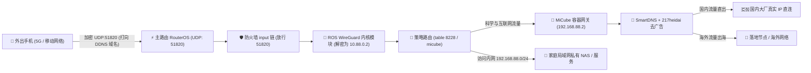

---

### 📋 严格执行四步法（为什么这个顺序绝不能颠倒？）

#### 🥇 第一步：先一键对齐 ROS (服务端端点、密钥与 DDNS 准备)
- **底层原理**：手机 WireGuard 客户端就像一把钥匙，ROS 上的 `wireguard1` 接口就像一把锁。在给手机配钥匙之前，必须先在锁里把**门牌号（公网 IP 或 Cloud DDNS 域名）**、**门铃端口（UDP 51820）**、**服务端公钥**与**隧道内网网段（如 10.88.0.1/24）**固定下来。如果这一步不对齐，后面生成的二维码配置就是“空号”或“错号”，手机扫了也是徒劳。
- **操作方式**：
  1. 在 MiCube 面板点击左侧【WireGuard】；
  2. 检查顶部的对齐状态矩阵，若显示未对齐，直接点击**「⚡ 一键对齐 RouterOS」**；
  3. MiCube 将通过 REST API 自动在 ROS 创建并校准 `wireguard1` 接口、生成私钥公钥、设置端口为 `51820`、绑定 `10.88.0.1/24` 并探查 ROS IP Cloud 动态域名。

#### 🥈 第二步：先调防火墙与策略路由规则 (大门放行与通道引流)
- **底层原理（新手最常踩的大坑！）**：
  - **防火墙必须先放行**：RouterOS 默认的防火墙安全机制极为严格，Filter Rules 的 `input` 链默认**直接丢弃 (DROP) 所有来自外网 WAN 口的未知连接**！即使第一步建好了 WireGuard 接口，如果不提前在防火墙放行 UDP 51820 端口，运营商进来的握手包会在第一道关卡被直接丢进垃圾桶。**如果先扫码连手机，手机发出的握手信号根本进不来，客户端会一直显示 `Handshake did not complete after 5 seconds`**！
  - **策略路由必须提前引流**：手机连入后分配的是 `10.88.0.x` 内网 IP。如果策略路由没有将 `10.88.0.0/24` 纳入分流标记，手机就算连回家也只能访问局域网 NAS，无法通过 MiCube 翻墙出海。
- **操作方式**：
  1. 在 MiCube 面板【系统状态】或 WireGuard 诊断卡片中，点击**「⚡ 一键配置防火墙与策略路由」**；
  2. 后台全自动在 ROS `ip firewall filter` 的 input 链顶部插入 `accept protocol=udp dst-port=51820` 放行规则，并自动下发 `table 8228` 策略路由引流规则。

#### 🥉 第三步：后在 Web 界面扫码导入手机 WireGuard
- **底层原理**：此时大门（防火墙端口）已敞开、路标（策略路由）已立好、端点（DDNS 与接口密钥）已对齐。此时在 MiCube 面板为手机创建 Peer，手机扫码即可直接握手成功。
- **操作方式**：
  1. 在手机应用商店（App Store / Google Play / 官方 APK）下载安装 **WireGuard** 官方客户端；
  2. 在 MiCube 面板【WireGuard】设备列表中，找到您的手机（或点击右上角「+ 添加设备」如 `iPhone 16 Pro`），点击右侧的**「📱 扫码配置」**；
  3. 手机打开 WireGuard App，点击右上角 `+` -> 选择 **「扫描二维码」**，扫描电脑屏幕上的二维码，命名保存并开启连接开关；
  4. 此时手机发出第 1 个 UDP 握手包，ROS 秒级响应，手机 WireGuard 界面内的「最新握手 (Latest Handshake)」在 1 秒内变为绿色（例如 `5 秒前`），同时产生双向传输数据流量！

#### 🏅 第四步：手机断开 Wi-Fi，切蜂窝移动网络验证
- **底层原理**：在手机连接家中 Wi-Fi 时测试穿透，可能会因路由器 NAT 回流（Hairpin NAT）未配置而连不上或产生假象。真正的内网穿透是在外面出差、旅游、喝咖啡时的漫游场景。
- **操作方式**：
  1. **关闭手机 Wi-Fi 开关**，切至运营商 5G / 4G 移动网络；
  2. 保持手机 WireGuard 处于已连接状态；
  3. **内网直通验证**：在手机 Safari / 浏览器中直接输入家庭内网 NAS 或路由器地址（如 `http://192.168.88.1` 或 `http://192.168.88.5:5000`），秒级打开即代表内网穿透成功！
  4. **全天漫游分流验证**：打开 YouTube 或 Google，秒开 4K 视频且无任何广告，证明手机已成功继承家中 MiCube 的全套 217heidai 去广告与 SmartDNS 加速能力！

---

## ❓ 常见新手排障问答 (Troubleshooting FAQ)

<details>
<summary><b>Q1: 容器启动了，为什么浏览器打不开 :2026 后台？</b></summary>
<br/>
1. 请检查创建容器时<b>网络模式是否选为了 host</b>。如果误选为 bridge，容器无法绑定主机端口；<br/>
2. 检查宿主机防火墙是否放行了 2026 端口；<br/>
3. 检查浏览器输入的 IP 是否是 NAS 或宿主机的真实局域网 IP。
</details>

<details>
<summary><b>Q2: 手机改了网关后，国内微信和网页正常，但打不开国外网站？</b></summary>
<br/>
1. 打开 MiCube 后台，点击左侧【节点选择】；<br/>
2. 确认是否已成功导入了有效的订阅节点，并点击“测速”，确保节点后方有绿色的延迟数字；<br/>
3. 确认左上角的「核心运行中」绿灯常亮。
</details>

<details>
<summary><b>Q3: 国内直连是否会消耗旁路由的 CPU？微信发图片会不会卡？</b></summary>
<br/>
完全不会！MiCube 拥有独创的<b>国内真实公网 IP 直连直出机制</b>，微信、淘宝、抖音、B站等国内大厂流量由 SmartDNS 直接解析为真实公网 IP，完全绕过 Fake-IP 池，不走内核加解密，直接由物理网卡线速转发，跑满满载带宽且 CPU 占用近乎为 0。
</details>

---

## 🔄 版本更新日志与迭代历程 (Changelog)

### 🧊 Test V0.91 (2026-10-15) · 面板极致简洁重构 (11 合为 5 大中枢)、脏状态保存感知、策略组折叠减负、10s 防抖测速与一键恢复推荐规则
- 🎛️ **面板导航极致精简与高人机效率重构 (11 项散乱 Tab ➔ 5 大生产力中枢)**：
  - 彻底淘汰此前 11 个孤立选项卡的冗长凌乱布局，根据用户心智模型重新收敛为 5 个核心中枢：
    1. 📊 **仪表总览 (Dashboard)**：核心健康度、分流状态、网络拓扑与快捷体检；
    2. 🌐 **节点分流 (Proxies Hub)**：聚合【节点选择】与【订阅配置】，节点切换与机场更新无缝衔接；
    3. 📱 **穿透协同 (WireGuard)**：手机移动端一键扫码穿透、密钥编排与握手烟花监控；
    4. 🛡️ **规则安全 (Rules Hub)**：聚合【去广告 MRS 拦截】、【实时流向透视】与【接入设备治理】；
    5. ⚙️ **系统运维 (System Hub)**：收纳【核心与系统升级】、【TG 机器人】、【AI 智脑诊断】与【镜像加速】。
  - 手机移动端底栏同步进化为 5 大主控坞，单手拇指即可一键穿透任意功能模块。
- 💾 **配置脏状态实时感知与智能防漏保存 (Dirty State Tracking)**：
  - 配置发生修改时，保存按钮由低调暗色秒级激活为「青蓝呼吸高亮 + 粒子发光提示」，明确标示 `💾 保存并编译 (已修改)`；
  - 若无未保存变动，按钮自动呈现暗态防误触 `✔ 配置已是最新`，杜绝用户反复纠结是否生效。
- 📦 **策略组智能折叠降噪与极简卡片视图 (Collapsible Policy Groups)**：
  - 针对拥有数十个机场几百上千个节点的场景，默认收拢节点列表，直接展示当前生效的选中出海节点与延迟胶囊；
  - 支持一键展开/收起，搭配即时节点检索过滤，彻底告别满屏节点滚动难找的视觉污染。
- ⏱️ **延迟测速 10 秒防抖重测与抗闪烁保护 (Anti-Flapping Retry)**：
  - 单次测速偶发超时或握手丢包时，自动触发 10 秒轻量级快速重测自愈机制；
  - 规避瞬时抖动导致的误报超时，测速结果更精准可信。
- 🔄 **出厂推荐分流规则一键恢复 (Reset Factory Rules)**：
  - 新增专用自愈接口 `/api/v1/config/rules/reset-defaults` 与控制台一键恢复按钮；
  - 无论规则如何调试改动，随时一键重置为官方最佳 GEO 与去广告策略，同时绝对保留用户的机场订阅与 WireGuard 密钥安全无损。

### 🧊 Test V0.9 (2026-10-15) · WireGuard 开箱向导 30s 自愈看门狗、RouterOS 快速熔断探针与飞牛存储池深度适配
- 🛡️ **WireGuard 开箱通关向导 30 秒超时自愈与「以后再说」快速跳过 (Skip & Resume later)**：
  - 彻底攻克初始化向导在 55%（创建/校准核心接口）处卡顿挂起的痛点；
  - 引入前端动态倒计时看门狗（Watchdog），支持在等待过程中随时点击【不想等待？点击【以后再说】】直达主控台；
  - 超时 30 秒后自动唤醒超时处理面板，提供【⏩ 以后再说（跳过并直接进入系统）】和【↻ 重新尝试】，绝不阻塞用户正常使用。
- 🔒 **RouterOS REST API 快速熔断探针与 Mutex 死锁根治**：
  - 重构 `AlignWireGuardToROS` 消除内部非可重入锁竞争，彻底杜绝请求死锁卡死；
  - 将 RouterOS HTTP 探针超时从 10 秒收紧至 3 秒轻量熔断保护，局域网异常或 ROS 服务未就绪时瞬间失败降级，不再长久悬挂。
- 🌐 **前端全局网络请求超时防挂死保护 (AbortController 熔断机制)**：
  - `apiFetch` 统一注入 AbortController 超时控制器，常规 API 15 秒超时、订阅拉取 60 秒超时、GeoData 规则包 120 秒超时，彻底杜绝前端无休止转圈与冻结。
- 🐳 **飞牛私有云 (fnOS) 专属存储路径深度适配与离线镜像秒级加载**：
  - 针对飞牛 NAS，自动将持久化目录对齐到用户主存储池 `/vol1/1000/micube`，数据安全沉淀在阵列池，系统重装或升级配置永不丢失；
  - 安装脚本新增对当前目录下的离线镜像包（`MiCube-${ARCH}.tar` / `micube.tar`）的自动探查与 `docker load -i` 秒级导入支持。
- 🧊 **离线规则种子包出厂内置与一键更新**：
  - 容器镜像出厂自带 `geoip.metadb` + `geosite.dat` + 核心 MRS 规则集，冷启动完全零外网依赖，国内网络秒级冷启；
  - 控制台新增一键更新卡片，随时同步最新 IP 分类与 217heidai 高速去广告规则。

### 🧊 Test V0.8 (2026-10-15) · 系统内存降至 50MB 出头、单二进制 10MB 出头、宿主网络底座第 0 步打通、WireGuard 1键向导烟花庆祝与权威指南
- 🚀 **系统常驻内存压榨至 50MB 出头 (实机 52.4MB) 与 10MB 安装包**：
  - 核心 TUN 协议栈深度对齐 Mihomo 最新 MipStack (`mips`)，纯 Go 零 CGO 零拷贝，结合 `GOMEMLIMIT=40MiB` 与 `GOGC=30`，常驻内存由 ~90MB 剧烈收缩至 **52.4MB**，相较传统方案省 80% 内存；
  - 后端单二进制经过符号剥离与编译优化，全平台尺寸控制在 10MB 出头（amd64 仅 12.6MB，arm64 仅 11.8MB）。
- 🖥️ **宿主机网络底座 (IPv4 转发与防火墙) 移至首位第 0 步治理**：
  - 针对 Docker 容器部署环境（飞牛 fnOS / PVE / Linux），将「宿主机网络底座与系统运维」卡片前置并置顶为首位关键步骤；
  - 强化新手避坑说明，提供一键免密 Shell 脚本与面板托管双重打通方案；
  - 仪表盘新增宿主机 `net.ipv4.ip_forward = 0` 实时阻断预警横幅与 4 步极速通关向导。
- 🎆 **WireGuard 手机极速通关 1 键向导与烟花庆祝 (Zero-Conf Wizard)**：
  - 全新研发 WireGuard 自动化通关向导：支持 1 键自动化完成「ROS 端点接口对齐 ➔ UDP 端口防火墙放行 ➔ 策略路由打通 ➔ 专属密钥生成 ➔ 扫码二维码呈现」；
  - 智能雷达 2 秒轮询监听客户端实时握手信号；
  - 手机扫码连接成功后，**瞬间在全屏绽放绚丽烟花庆祝**（Canvas 粒子物理引擎），直观呈现双向收发流量与握手毫秒数！
- 🎛️ **全新独立【节点选择】控制台与实时交互**：
  - 新增全功能【节点选择】交互视窗，支持单节点及策略组毫秒级并发延迟测速；
  - 呈现直观三色延迟胶囊（<150ms 翠绿 / <300ms 暖橙 / 超时 绯红），支持按「全部分组、自动选路、故障转移、直连、手工选择」一键分类筛选；
  - 修复机场无效节点过滤算法，彻底解决将包含带宽标识（如 `1Gbps`、`10Gbps`）或英国 `GB` 国家标签误杀的缺陷，订阅节点计数 100% 真实。
- 🛡️ **出口策略组细化重构：地区故转 vs 地区容灾**：
  - 消除原“故转”与“故障转移”重复简称歧义，规范划分为「🛡️ 地区故转 (顺序顺延 / IP稳定，适合 ChatGPT 与网银)」与「🌐 地区容灾 (应急备选灾备)」及「⚡ 地区自动 (最低延迟优先)」；
  - 编译器与前端控制面板无缝联动对齐。
- 📱 **WireGuard 权威使用指南与四大优势规范**：
  - 详尽剖析 WireGuard **无需公网 IPv4、彻底规避暴露内网 IPv6 高危风险、三层穿透整个局域网、100% 永久免费与军工级静默安全** 五大核心优势；
  - 确立「① 先对齐 ROS ➔ ② 先调防火墙与策略路由 ➔ ③ 后在面板扫码 ➔ ④ 断开 Wi-Fi 验证」标准执行四步法与原理流程图。

<details>
<summary><b>📜 点击展开查看历史版本更新记录 (Test V0.7 ~ V0.1) ▾</b></summary>
<br/>

### 🧊 Test V0.7 (2026-10-15) · 飞牛 (fnOS) / Linux 宿主机深度协同、同网段多网关自愈分流与 RouterOS 完整版本真机呈现
- 🖥️ **飞牛 (fnOS) / Linux 宿主机深度协同与 Docker 穿透优化**：
  - 为 Docker 部署模式量身打造宿主机 SSH 协同引擎（支持飞牛 fnOS、PVE、群晖 DSM、Debian/Ubuntu 等 Linux 宿主）；
  - 支持一键部署宿主机 WireGuard 服务（`wg0.conf`、开机自启、开启内核 IPv4 转发与 UDP 13231 防火墙放行），绕过 Docker 网桥实现满载内网线速直通；
  - Web 界面增删/重命名 WireGuard 客户端时，后台全自动静默向宿主机执行 `wg set wg0 peer ...` 动态热对齐；
  - 提供宿主机免密 1 键 Shell 脚本（`curl | sudo bash`），无须在面板保存 SSH 凭证即可 2 秒完成配置；
  - 支持宿主机系统升级在线检测与一键升级（`apt update && apt upgrade -y` / fnOS 更新），面板内置实时终端日志视窗。
- 🛡️ **同号段多网关 / 传统纯旁路由模式避坑与 1 键净化**：
  - 深度治理同局域网存在多个网关或 DHCP 下发自定义 DNS 时的冲突痛点：优化 RouterOS DNS 重定向规则，限制仅对发往主路由的直连请求生效，杜绝向其他同号段网关/DNS 发包时的递归死锁；
  - 新增「🌾 一键停用 Mangle/DNS 劫持 (经典纯旁路由模式)」，支持一键移除 RouterOS 强控标记，局域网终端只需将网关/DNS 手动指向 MiCube 即可享受全功能科学分流，与局域网其他网关互不干扰。
- 🏷️ **RouterOS 完整版本号全真呈现 (Zero Truncation)**：
  - 彻底重构平台探查与格式化逻辑，移除历史版本硬编码截断，优先读取真机固件版本与硬件架构（如 `RouterOS v7.18.2 (stable)`、`RouterOS v7.18.2 · CHR`）；
  - 面板顶栏、左侧栏 Hero 徽章、移动端抽屉与仪表盘平台卡片全方位拓宽视宽并附带完整悬浮浮窗提示。
- ⚡ **对齐 Mihomo 最新 Alpha 内核协议规范**：
  - 启用新一代 `endpoint-independent-nat: true`（全锥型 NAT 优化）；
  - TUN 栈原生支持 `mips` 轻量高效栈；
  - 注入高频国内直连 UDP 首包并发竞速（阿里 `223.5.5.5` + 腾讯 `119.29.29.29`）。

### 🧊 Test V0.6 (2026-10-15) · RouterOS 原生联动对齐、全自动策略路由下发与灾备系统
- 🛡️ **RouterOS 防火墙与策略路由全自动体检与一键配置**：
  - 新增专用策略路由诊断矩阵，自动体检 `/routing/table`（`micube` 表）、默认网关路由（`0.0.0.0/0 via MiCube`）、Mangle prerouting/redirect 标记（`mark: 0x2026`）、防死锁回环白名单（`MICUBE_BYPASS`）以及严格防 DNS 泄露规则（53 端口重定向与 SERVFAIL 阻断）。
  - 支持在 Web 面板直接点击「⚡ 一键配置到 RouterOS」通过 REST API 全自动下发就绪，无需手动操作 WinBox。
- ⚡ **取消复制终端命令行，全面升级为 REST API 原生直通**：
  - 取消弹窗强制要求用户复制 WinBox 脚本的旧操作，WireGuard 服务端、客户端 Peers 以及策略路由全部由后台 REST API 原生直通；
  - 依然贴心保留「WinBox 终端脚本 (备用)」一键复制选项，供无 REST API 环境手工审计备用。
- 📱 **WireGuard 与 RouterOS 实时对齐矩阵**：
  - 新增 WireGuard 接口、IP 网段、UDP 防火墙端口、IP Cloud 动态域名及所有 Peer 授权密钥的实时对齐检查卡片与一键对齐按钮；
  - 支持已授权客户端 Peer 在线重命名（`✏️ 改名`），名称自动同步至 RouterOS comment 备注。
- 🌏 **严格 7 大标准地区分组与零乱码保证**：
  - 节点地区分组严格限定为「香港、台湾、新加坡、韩国、日本、美国、其它」，其余所有未知地区节点一律自动汇入「其它」，彻底规避杂乱自定义分组；
  - 核心订阅编译器注入 UTF-8 严格清洗，全栈 HTTP/JSON/静态文件响应注入 `charset=utf-8`，彻底消除不同操作系统下的字符乱码问题。
- 💾 **系统配置全量备份与一键恢复 (Backup & Restore)**：
  - 新增系统全量配置导出与恢复引擎，支持一键导出包含节点订阅、分流规则、WireGuard 服务端与 Peer 私钥、RouterOS 凭据与设备备注的 `.json` 灾备文件；
  - 支持在任何全新或迁移设备上一键导入秒级还原，零数据丢失。
- 🏷️ **局域网设备按 IP 与 MAC 自定义备注**：
  - 设备管理与实时会话中全面支持按设备 IP 地址或 MAC 物理地址绑定友好名称（如“客厅电视”、“NAS”），多视图统一联动呈现。
- 📋 **HTTP 局域网剪贴板复制 100% 容错回退机制**：
  - 彻底解决现代浏览器在非安全上下文（纯 HTTP 局域网 IP）下 `navigator.clipboard` 被静默拦截的问题，通过兼容选择区回退机制保证一键复制成功率 100%。

### 🧊 Test V0.5 (2026-10-15) · 极速首包 DNS 竞速、升级预检自愈与全平台一键部署
- ⚡ **DNS 极速首包混合并发竞速**：在 `nameserver` 与 `direct-nameserver` 中将顶级纯 IP UDP DNS（`223.5.5.5`, `119.29.29.29`）与加密 DoH 深度融合，纯 UDP 负责 2~5ms 闪电首包响应，DoH 负责防劫持加密保底，实现真正的超低延迟立体并发竞速。
- 🛡️ **更新包 ELF 完整性与尺寸预检**：升级引擎引入 Pre-Flight 预检机制，升级二进制下载完成后先进行最低尺寸（5MB）与 Linux ELF Magic Header 签名校验，校验通过才执行原子替换，彻底规避因网络波动下载残缺文件导致服务瘫痪。
- 🔄 **原子级平滑备份与回滚**：二进制覆盖前自动备份为 `micube-server.bak`，保留回退锚点，全流程零人工干预自愈。
- 🚀 **新增全自动 1-Click 极速部署脚本 (`scripts/install.sh`)**：全自动识别 CPU 架构（amd64 / arm64）、探查当前物理网卡与网关、开启内核 IPv4 转发并自动拉起 MiCube 高性能容器，飞牛 fnOS、PVE、通用 Linux 一键秒级上车！

### 🧊 Test V0.4 (2026-10-15) · MipStack 协议栈与全状态自愈升级
- 🚀 **TUN 协议栈全面升级为 MipStack (`mips`)**：全面对齐 Mihomo 最新 Alpha 核心协议规范，TUN 栈由 `mixed` 升级为专有轻量高性能协议栈 `mips`，原生集成 Google BBR / BBRv3 拥塞控制算法，大幅降低内存开销与 GC 停顿，彻底杜绝容器低内存下的网络波动与崩溃。
- ⚡ **上游 DNS 并发竞速全链路覆盖**：国内 DoH 双擎竞速（阿里 vs 腾讯）、海外 DoH 双雄竞速（Cloudflare vs Google）、未命中域名跨域并发交叉竞速与防污染兜底、出站直连 UDP/DoH 混合竞速，并强制注入 `tcp-concurrent: true` 开启 TCP 多 IP 极速并发握手。
- 🖥️ **宿主平台与系统版本完整呈现**：彻底解决平台徽章与版本号字符截断问题，左侧栏 Hero 徽章、移动端顶栏与仪表盘平台卡片完整呈现宿主准确版本（如 `RouterOS v7.24.5 (stable)`）。
- 🔄 **全站版本号动态响应绑定**：彻底移除模板中历史遗留的静态写死版本占位符，面板顶部、侧边栏底部、移动端抽屉全站统一动态响应绑定 `Test V0.4`。
- 🛡️ **核心启动安全回滚自愈机制**：启动守护脚本 `micube-ctl` 新增安全回退保护：当主配置文件解析异常导致核心启动失败时，自动回滚至 `config.yaml.bak` 备份配置拉起核心，防止错误配置导致无法进入管理面板。
- 🛠️ **双向一键强制自愈**：系统设置中新增「🔄 强制修复/重装面板」与「🔄 强制重拉内核」按钮，支持在网络波动中断时一键无损修复覆盖。
- 🐳 **RouterOS 容器自愈增强**：一键安装脚本 `install-routeros.rsc` 默认加入 `restart-policy=always`，确保护航容器在宿主重启后自动自愈恢复。

### 🧊 Test V0.3 (2026-10-15) · Alpha 内核跟踪与 OTA 在线热升级
- ⬆️ **全面集成 OTA 在线热升级引擎**：支持面板服务与 Mihomo 内核一键平滑热升级，自动更新 `meta.json` 并保持配置持久化。
- 🔍 **Mihomo Alpha 测试版全自动跟踪**：升级引擎支持跟踪 `Prerelease-Alpha` 语义版本并获取直链下载。
- ⚡ **KSpeeder 多源镜像加速**：国内环境拉取 GitHub 资源自动并发优选高速镜像源。

### 🧊 Test V0.2 (2026-10-15) · 多架构适配与 WireGuard 原生联动
- 📱 **RouterOS 原生 WireGuard 一键扫码**：自动探测 RouterOS IP Cloud DDNS，一键生成标准手机穿透二维码。
- 🗜️ **217heidai MRS 高速去广告**：集成 23.3 万条权威广告与隐私追踪过滤规则，毫秒级 REJECT 阻断。
- 🌐 **国内真实 IP 直连直出**：国内流量与局域网彻底绕过 Fake-IP 映射池，由国内 DNS 解析真实公网 IP 直连直出。

### 🧊 Test V0.1 (2026-10-14) · 官方首发版本
- 纯 Go 单二进制单体架构 `micube-server`，内存占用 ~90MB 级别。
- 专为 MikroTik RouterOS v7 设计的科技深蓝毛玻璃 UI。

</details>

---

## 📜 版权与开源许可证声明 (License & Copyright)

本项目的服务端二进制程序（`micube-server`）、系统架构体系及专属 WebUI 控制台属于 **zyeyefyass** 拥有 100% 独立知识产权的专有闭源成果。

- **个人用户**：享有完全免费用于个人家庭路由与 NAS 设备之权利；
- **商用与二次分发**：严禁未经书面许可用于任何商业售卖、付费中转引流、反编译破解或贴牌篡改；
- 详情请查阅 [LICENSE](./LICENSE) 与 [DECLARATION.md](./DECLARATION.md)。

---

<div align="center">
  <b>MiCube · 专有高性能旁路由系统 · Test V0.91</b><br/>
  Crafted with ❤️ by <a href="https://github.com/zyeyefyass">zyeyefyass</a>
</div>
